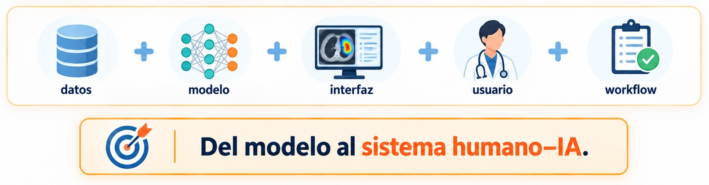
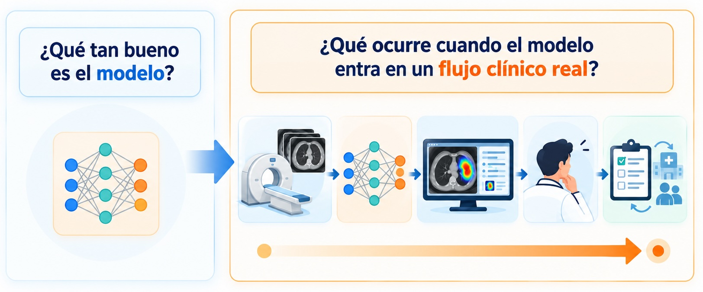
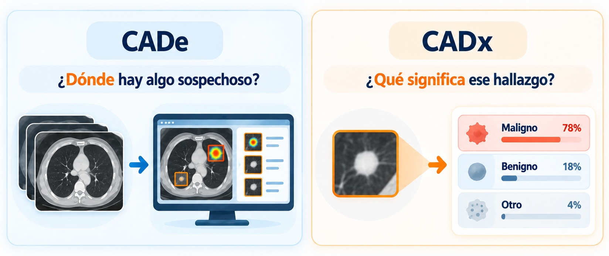
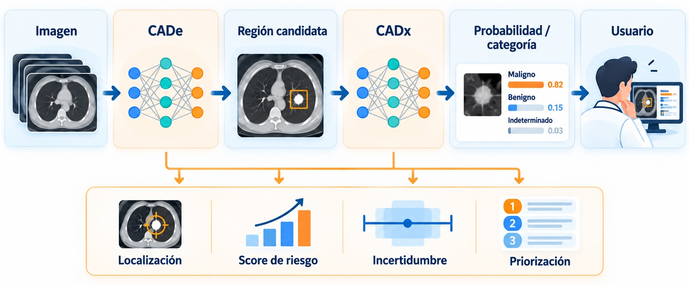
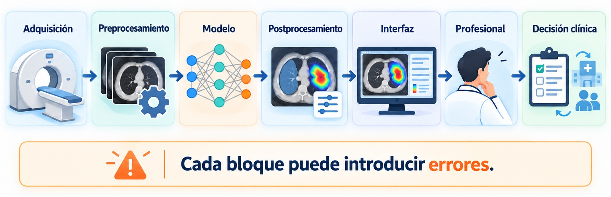
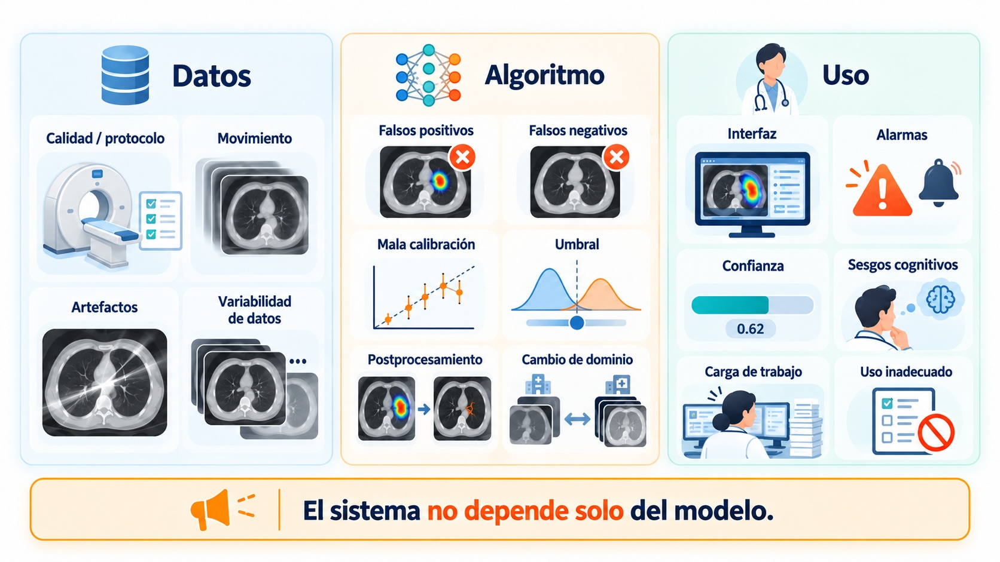
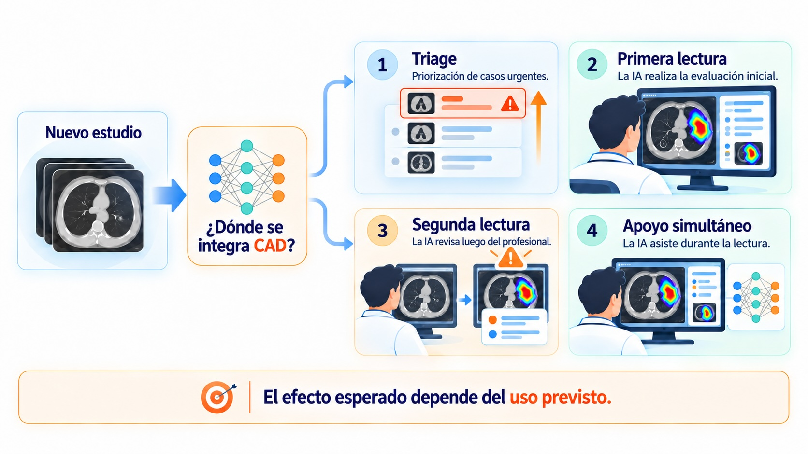
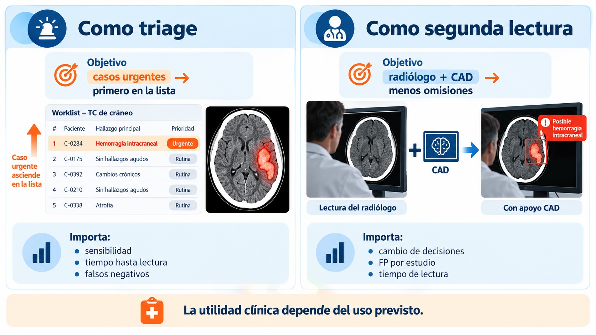

## Del modelo al sistema clínico

### Hasta ahora analizamos componentes:

- clasificación y detección;
- calibración e incertidumbre;
- explicabilidad.

:::{.callout .centered .warning}
Pero una buena red neuronal **todavía no es una herramienta clínica**.
:::

{ width=80% .centered}

## Pregunta guía

{ width=80% .centered}

## Objetivos de la clase

Al final deberíamos poder:

1. distinguir **CADe** de **CADx**;
2. reconocer dónde puede fallar un sistema CAD completo;
3. diferenciar validación interna, externa, temporal y prospectiva;
4. interpretar métricas en función de **prevalencia y población**;
5. entender el lugar de **federated learning** en escenarios multicéntricos;
6. evaluar críticamente un dataset sin confundir benchmark con práctica clínica.


# 1. CAD: del algoritmo al sistema

## ¿Qué es CAD?

**Computer-Aided Detection / Diagnosis**

Sistemas computacionales diseñados para **asistir** al profesional en tareas de detección, caracterización o diagnóstico.

{ width=80% .centered}

## CADe y CADx no son excluyentes

{ width=80% .centered}

## Un pipeline CAD completo

{ width=80% .centered}

## ¿Dónde puede fallar?

{ width=80% .centered}


## Human-in-the-loop

En muchas aplicaciones, el objetivo no es reemplazar al profesional.

```{mermaid}
#| echo: false

flowchart LR
    H[Humano] <--> C((+)) <--> IA[IA]
    classDef human fill:#DCEBFA,stroke:#3973AC,stroke-width:2px,color:#17324D
    classDef assist fill:#E2F3E8,stroke:#3A8F5B,stroke-width:2px,color:#194D2D
    classDef plus fill:#FFF3CD,stroke:#B8860B,stroke-width:2px,color:#5C4500
    class H human
    class C plus
    class IA assist
```

La IA puede:

- priorizar estudios
- señalar regiones
- ofrecer una segunda lectura
- estimar riesgo
- sugerir una clasificación
- derivar casos inciertos


## El mismo modelo, cuatro usos distintos

{ width=80% .centered}

## Ejemplo: detector de hemorragia intracraneal

{ width=80% .centered}

## Sesgos de la automatización

Un sistema consistente puede modificar la conducta humana.

$$
\text{modelo dice negativo}
\Rightarrow
\text{menor búsqueda activa}
$$

$$
\text{modelo marca una región}
\Rightarrow
\text{atención concentrada allí}
$$

::: {.fragment}
> El CAD puede **crear errores nuevos** que no ocurrirían sin asistencia.
:::


## El problema opuesto: fatiga de alertas

Si el sistema genera demasiadas alarmas:

```{mermaid}
flowchart LR
    A[Muchos falsos positivos] --> B[Sobrecarga]
    B --> C[Pérdida de confianza]
    C --> D[Alertas ignoradas]
```

::: {.fragment}
Un detector con recall muy alto puede ser clínicamente inútil si produce demasiadas marcas por estudio.
:::


## Primera idea clave

$$
\boxed{
\text{métrica del modelo}
\neq
\text{utilidad clínica}
}
$$

Para evaluar un sistema necesitamos estudiar:

- algoritmo;
- interfaz;
- usuario;
- población;
- workflow;
- consecuencia de los errores.


# 2. De validación técnica a validación clínica

## La escalera de validación

```{mermaid}
flowchart LR
    A[Desempeño técnico] --> B[Validación interna]
    B --> C[Validación externa]
    C --> D[Evaluación con usuarios]
    D --> E[Evaluación prospectiva]
    E --> F[Impacto clínico]
```

::: {.fragment}
Cada escalón responde una pregunta diferente.
:::


## Validación interna

Evaluamos con datos provenientes de una población similar a la utilizada para desarrollar el modelo.

$$
\mathcal D
=
\mathcal D_{train}
\cup
\mathcal D_{val}
\cup
\mathcal D_{test}
$$

Pero en imágenes médicas importa **qué unidad estamos separando**.


## La unidad de partición

En muchos problemas médicos:

$$
\boxed{\text{unidad de split} = \text{paciente}}
$$

no:

$$
\boxed{\text{unidad de split} = \text{imagen}}
$$

::: {.fragment}
Porque múltiples imágenes pueden compartir información clínica, anatómica y de adquisición.
:::


## Leakage no es solo repetir pacientes

También puede aparecer cuando:

- usamos todo el dataset para normalizar;
- ajustamos preprocessing mirando el test;
- seleccionamos hiperparámetros con el test;
- mezclamos estudios longitudinales del mismo paciente;
- hacemos feature selection antes del split.

::: {.fragment}
> El test debe permanecer **informacionalmente aislado** hasta la evaluación final.
:::


## Validación externa

Usamos datos independientes del conjunto de desarrollo.

Idealmente:

- otro hospital
- otra región
- otros equipos;
- otros protocolos;
- otra población.

$$
P_{external}(x,y)
\neq
P_{development}(x,y)
$$


## El modelo funcionaba muy bien…

$$
AUC_{interno}=0.94
$$

pero:

$$
AUC_{externo}=0.79
$$

::: {.fragment}
¿El modelo está “mal”?
:::

::: {.fragment}
No necesariamente. Puede estar revelándose un **domain shift**.
:::


## ¿De dónde viene el *domain shift*?

```{mermaid}
flowchart TD
    S[Domain shift] --> A[Población]
    S --> B[Prevalencia]
    S --> C[Scanner]
    S --> D[Protocolo]
    S --> E[Reconstrucción]
    S --> F[Criterio diagnóstico]
```

La validación externa prueba dependencias que el test interno puede ocultar.


## ¿Y si queremos entrenar con varios hospitales?

La validación externa nos muestra que distintos centros pueden tener distribuciones diferentes.

Una respuesta natural sería entrenar con datos de varios hospitales.

Pero aparece una restricción frecuente:

$$
\boxed{\text{los datos clínicos no siempre pueden centralizarse}}
$$

::: {.fragment}
Ahí aparece **Federated Learning**.
:::


## Federated Learning: idea básica

```{mermaid}
flowchart LR
    S[Modelo global] --> A[Hospital A]
    S --> B[Hospital B]
    S --> C[Hospital C]

    A --> UA[Actualización local]
    B --> UB[Actualización local]
    C --> UC[Actualización local]

    UA --> G[Agregación]
    UB --> G
    UC --> G
    G --> S
```

::: {.fragment}
Los **datos permanecen en cada institución**.
:::

::: {.fragment}
Lo que se intercambia son parámetros, gradientes o actualizaciones del modelo.
:::


## ¿Qué problema intenta resolver?

Federated learning puede permitir:

- entrenar con datos multicéntricos sin reunirlos físicamente
- incorporar mayor diversidad de scanners, protocolos y poblaciones
- colaborar entre instituciones con restricciones de gobernanza de datos

Pero:

$$
\boxed{\text{Federated Learning} \neq \text{privacidad garantizada}}
$$

Persisten desafíos como:

- seguridad de las actualizaciones
- heterogeneidad entre centros
- datos **non-IID**
- tamaños de muestra muy diferentes
- distinta prevalencia y calidad de etiquetas


## Federated training no es validación externa

Supongamos que entrenamos federadamente con:

$$
A+B+C \rightarrow \text{modelo federado}
$$

¿Evaluar el modelo en A, B y C constituye validación externa?

::: {.fragment}
**No.** Esos centros participaron en el desarrollo.
:::

Una evaluación más fuerte sería:

$$
\boxed{
A+B+C \rightarrow \text{entrenamiento federado}
}
$$

$$
\boxed{
D \rightarrow \text{validación externa}
}
$$

::: {.fragment}
> Aprender de múltiples centros puede mejorar la robustez, pero no elimina la necesidad de validación independiente.
:::


## Validación temporal

Otra forma de simular despliegue:

$$
\text{train: 2018--2023}
$$

$$
\text{test: 2024--2025}
$$

::: {.fragment}
Entrenamos con el pasado y evaluamos sobre **pacientes futuros**.
:::

Puede revelar cambios en:

- práctica clínica
- protocolos
- equipos
- población


## Retrospectivo vs prospectivo

::: {.columns}
::: {.column width="48%"}
### Retrospectivo

Datos ya existentes.

Ventajas:
- rápido;
- barato;
- control experimental.

Limitación:
- reproduce imperfectamente el workflow real.
:::

::: {.column width="48%"}
### Prospectivo

El protocolo se define **antes** de observar nuevos casos.

Ventaja:
- mayor realismo clínico.

Costo:
- tiempo;
- logística;
- complejidad.
:::
:::


# 3. ¿Mejora al profesional?

## AUC = 0.95… ¿y ahora?

Un modelo puede tener:

$$
AUC=0.95
$$

y aun así no sabemos:

$$
\boxed{\text{¿mejora el desempeño del profesional?}}
$$

Para responderlo necesitamos comparar:

$$
\text{humano sin IA}
\quad vs \quad
\text{humano + IA}
$$


## Un diseño más realista

::: {.columns}
::: {.column width="48%"}
### Evitar

- siempre “sin IA” primero;
- mismos casos inmediatamente después;
- orden fijo;
- lectores no representativos.
:::

::: {.column width="48%"}
### Preferir

- orden aleatorizado;
- washout;
- múltiples lectores;
- múltiples casos;
- condición clínica plausible.
:::
:::


## Una paradoja posible

Puede ocurrir:

$$
\text{modelo} > \text{humano}
$$

cuando se evalúan aislados,

pero:

$$
\text{humano + modelo} < \text{humano}
$$

cuando trabajan juntos.


## ¿Cómo puede ocurrir?

```{mermaid}
flowchart LR
    A[Buen modelo] --> B{Integración}
    B -->|Mala| C[Automation bias]
    B -->|Mala| D[Alert fatigue]
    B -->|Mala| E[Interfaz confusa]
    B -->|Mala| F[Sobreconfianza]
    C --> G[Peor sistema]
    D --> G
    E --> G
    F --> G
```


## Segunda idea clave

$$
\boxed{
\text{desempeño humano–IA}
\text{ no se deduce }
\text{del desempeño del modelo aislado}
}
$$

## ¿Qué pregunta responde cada diseño?

| Diseño | Pregunta |
|--- |---|
| Test interno | ¿Generaliza dentro de mi cohorte? |
| Externo | ¿Generaliza a otro dominio? |
| Temporal | ¿Generaliza hacia el futuro? |
| Prospectivo | ¿Funciona cuando se despliega bajo protocolo real? |
| Reader study | ¿Mejora al profesional? |


# 4. Datasets: el benchmark no es el hospital

## El benchmark no es el hospital

Los datasets públicos son fundamentales para:

- desarrollo inicial;
- reproducibilidad;
- comparación de métodos;
- enseñanza e investigación.

Pero:

$$
P_{benchmark}(x,y)
\neq
P_{clínica}(x,y)
$$

::: {.fragment}
$$
\boxed{\text{buen resultado en benchmark}}
\not\Rightarrow
\boxed{\text{buen desempeño clínico}}
$$
:::


## Antes de usar un dataset

::: {.columns}
::: {.column width="48%"}
### ¿De dónde vienen los datos?

- población;
- criterios de inclusión;
- centro / centros;
- modalidad y protocolo;
- prevalencia.
:::

::: {.column width="48%"}
### ¿Qué significa la referencia?

- etiqueta por imagen, lesión o paciente;
- uno o varios expertos;
- consenso;
- patología / seguimiento;
- split por paciente;
- licencia.
:::
:::

::: {.fragment}
> Un dataset es una muestra de un **proceso clínico y técnico**, no solo una carpeta de archivos.
:::


## Las etiquetas también tienen incertidumbre

En muchos problemas médicos:

$$
y^{(1)} \neq y^{(2)}
$$

puede ser completamente razonable.

La referencia puede provenir de:

- un lector;
- consenso;
- múltiples lectores;
- patología;
- seguimiento clínico.

::: {.fragment}
> El error del modelo debe interpretarse en relación con la incertidumbre de la referencia.
:::


## Algunos datasets 

| Dataset | Modalidad | Anotación / uso típico |
|---|---|---|
| CheXpert / MIMIC-CXR | RX | clasificación; etiquetas derivadas de reportes |
| VinDr-CXR | RX | detección; bounding boxes |
| LIDC-IDRI | CT | nódulos; múltiples lectores |
| BraTS | MRI | segmentación de tumor cerebral |
| KiTS | CT | segmentación de riñón / tumor |
| TCIA | varias | colecciones oncológicas heterogéneas |

::: {.fragment}
No necesitamos memorizar la lista. Lo importante es preguntar:

$$
\boxed{\text{¿este dataset representa la pregunta clínica que quiero estudiar?}}
$$
:::


# 5. Integración conceptual de la unidad

## De la imagen al sistema clínico

```{mermaid}
flowchart TD
    A[Imagen médica] --> B[Clasificación / detección]
    B --> C[Score]
    C --> D[Calibración]
    D --> E[Incertidumbre]
    B --> F[Explicabilidad]
    E --> G[Sistema CAD]
    F --> G
    G --> H[Validación interna]
    H --> I[Validación externa]
    I --> M[Robustez multicéntrica / FL]
    M --> J[Evaluación clínica]
```


## La pregunta fue cambiando

Al comienzo de la unidad:

$$
f_\theta(x)
$$

¿Cómo hago una buena predicción?

::: {.fragment}
Al final:

$$
\boxed{
\text{¿cómo se comporta el sistema completo en una población real?}
}
$$
:::


## Cinco niveles que no debemos confundir

```{mermaid}
flowchart LR
    A[1. Predicción] --> B[2. Probabilidad]
    B --> C[3. Incertidumbre]
    C --> D[4. Explicación]
    D --> E[5. Utilidad clínica]
```

Una mejora en un nivel **no garantiza** una mejora en el siguiente.


## Qué debería informar un estudio serio

Como mínimo:

- población y criterios de inclusión
- split y prevención de leakage
- métricas y umbral
- calibración cuando corresponda
- análisis por subgrupos
- validación externa
- intended use
- limitaciones


## Checklist antes de confiar en un resultado

::: {.columns}
::: {.column width="48%"}
### Dataset

- ¿representativo?
- ¿split por paciente?
- ¿ground truth?
- ¿prevalencia?
:::

::: {.column width="48%"}
### Sistema

- ¿uso previsto?
- ¿validación externa?
- ¿generalización multicéntrica?
- ¿usuarios reales?
- ¿impacto en workflow?
:::
:::


## Tres frases para llevarse

::: {.fragment}
### 1
**Un modelo no es un sistema clínico.**
:::

::: {.fragment}
### 2
**Un test interno no demuestra generalización clínica.**
:::

::: {.fragment}
### 3
**Aprender de más centros no reemplaza validar en una población independiente.**
:::


## Cierre de la unidad

$$
\boxed{
\text{buena predicción}
\neq
\text{sistema clínicamente útil}
}
$$

Para pasar de un modelo experimental a una herramienta clínica necesitamos considerar simultáneamente:

$$
\boxed{
\text{desempeño}
+
\text{robustez}
+
\text{incertidumbre}
+
\text{explicabilidad}
+
\text{validación}
+
\text{integración clínica}
}
$$

