## Del modelo al sistema clínico

### Hasta ahora analizamos componentes:

- clasificación y detección;
- calibración e incertidumbre;
- explicabilidad.

:::{.callout .centered .warning}
Pero una buena red neuronal **todavía no es una herramienta clínica**.
:::

{ width=80% .centered}

## Pregunta guía

{ width=80% .centered}

## Objetivos de la clase

Al final deberíamos poder:

1. distinguir **CADe** de **CADx**;
2. reconocer dónde puede fallar un sistema CAD completo;
3. diferenciar validación interna, externa, temporal y prospectiva;
4. interpretar métricas en función de **prevalencia y población**;
5. entender el lugar de **federated learning** en escenarios multicéntricos;
6. evaluar críticamente un dataset sin confundir benchmark con práctica clínica.


# 1. CAD: del algoritmo al sistema

## ¿Qué es CAD?

**Computer-Aided Detection / Diagnosis**

Sistemas computacionales diseñados para **asistir** al profesional en tareas de detección, caracterización o diagnóstico.

{ width=80% .centered}

## CADe y CADx no son excluyentes

{ width=80% .centered}

## Un pipeline CAD completo

{ width=80% .centered}

## ¿Dónde puede fallar?

{ width=80% .centered}


## Human-in-the-loop

En muchas aplicaciones, el objetivo no es reemplazar al profesional.

```{mermaid}
%%| echo: false

flowchart LR
    H[Humano] <--> C(("+")) <--> IA[IA]
    classDef human fill:#DCEBFA,stroke:#3973AC,stroke-width:2px,color:#17324D
    classDef assist fill:#E2F3E8,stroke:#3A8F5B,stroke-width:2px,color:#194D2D
    classDef plus fill:#FFF3CD,stroke:#B8860B,stroke-width:2px,color:#5C4500
    class H human
    class C plus
    class IA assist
```

La IA puede:

- priorizar estudios
- señalar regiones
- ofrecer una segunda lectura
- estimar riesgo
- sugerir una clasificación
- derivar casos inciertos


## El mismo modelo, cuatro usos distintos

{ width=80% .centered}

## Ejemplo: detector de hemorragia intracraneal

{ width=80% .centered}

## Sesgos de la automatización

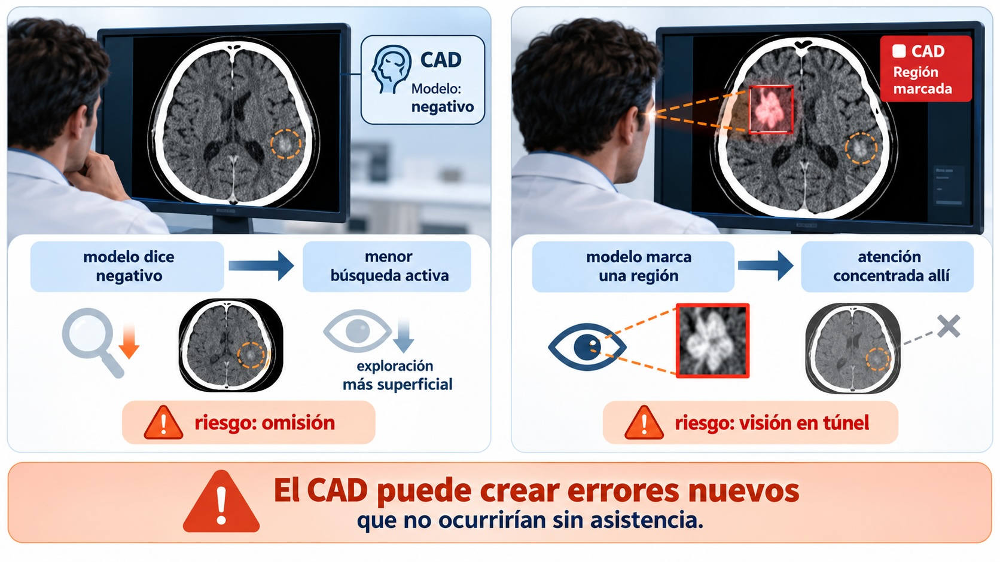{ width=80% .centered}

## El problema opuesto: fatiga de alertas

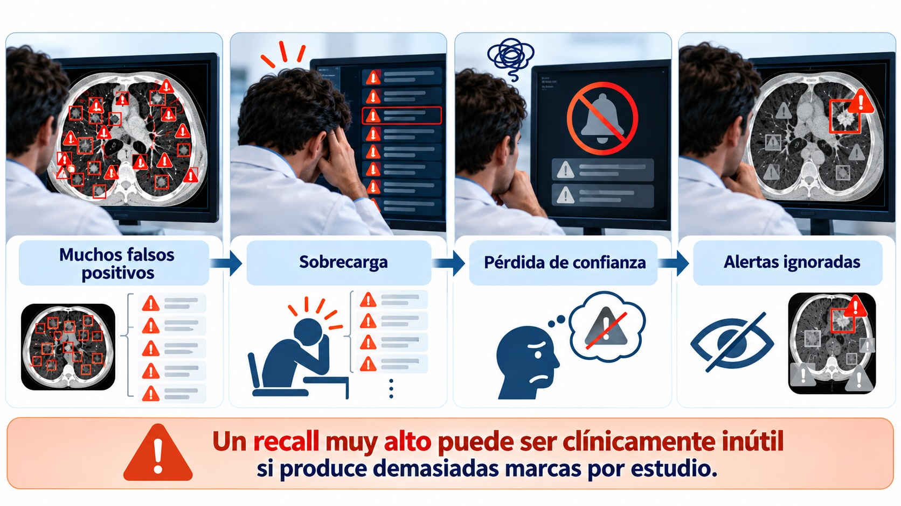{ width=80% .centered}

## Idea clave

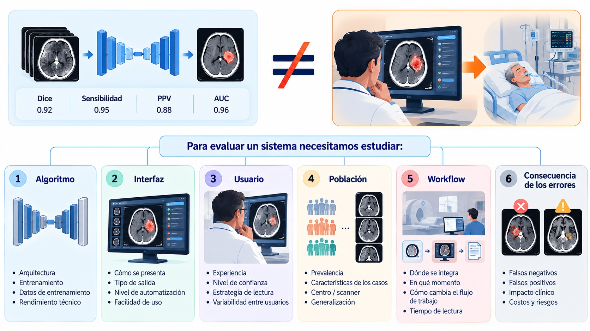{ width=80% .centered}

# 2. De validación técnica a validación clínica

## La escalera de validación

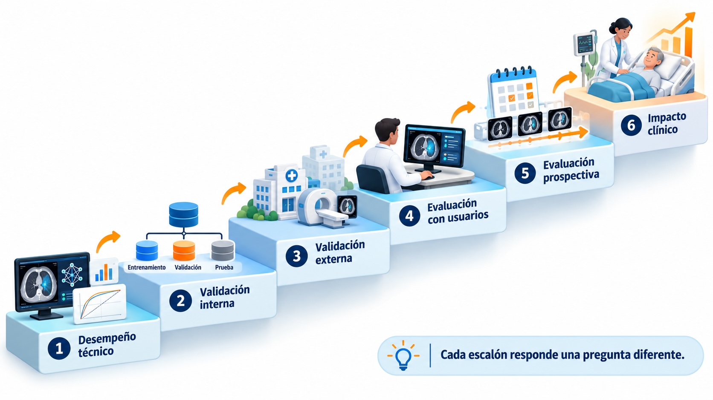{ width=80% .centered}

## Validación interna

Evaluamos con datos provenientes de una población similar a la utilizada para desarrollar el modelo.

$$
\mathcal D
=
\mathcal D_{train}
\cup
\mathcal D_{val}
\cup
\mathcal D_{test}
$$

Pero en imágenes médicas importa **qué unidad estamos separando**.


## La unidad de partición

En muchos problemas médicos:

$$
\boxed{\text{unidad de split} = \text{paciente}}
$$

no:

$$
\boxed{\text{unidad de split} = \text{imagen}}
$$

::: {.fragment}
Porque múltiples imágenes pueden compartir información clínica, anatómica y de adquisición.
:::


## Leakage no es solo repetir pacientes


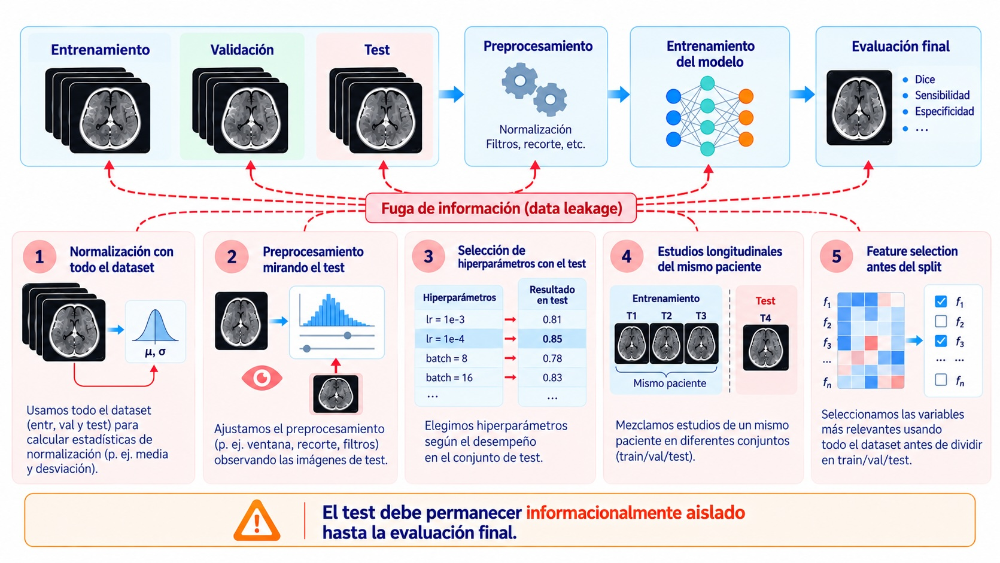{ width=80% .centered}

## Validación externa

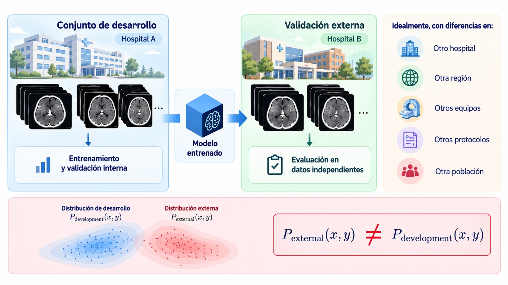{ width=80% .centered}

## El modelo funcionaba muy bien… ¿De dónde viene el *domain shift*?

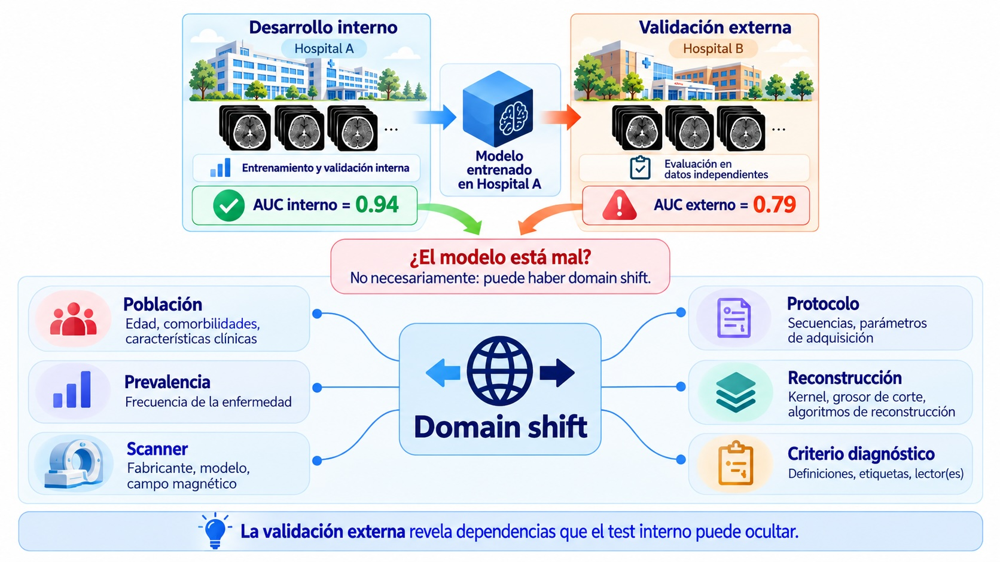{ width=80% .centered}


## ¿Y si queremos entrenar con varios hospitales?

La validación externa nos muestra que distintos centros pueden tener distribuciones diferentes.

Una respuesta natural sería entrenar con datos de varios hospitales.

Pero aparece una restricción frecuente:

$$
\boxed{\text{los datos clínicos no siempre pueden centralizarse}}
$$

::: {.fragment}
Ahí aparece **Federated Learning**.
:::


## Federated Learning: idea básica

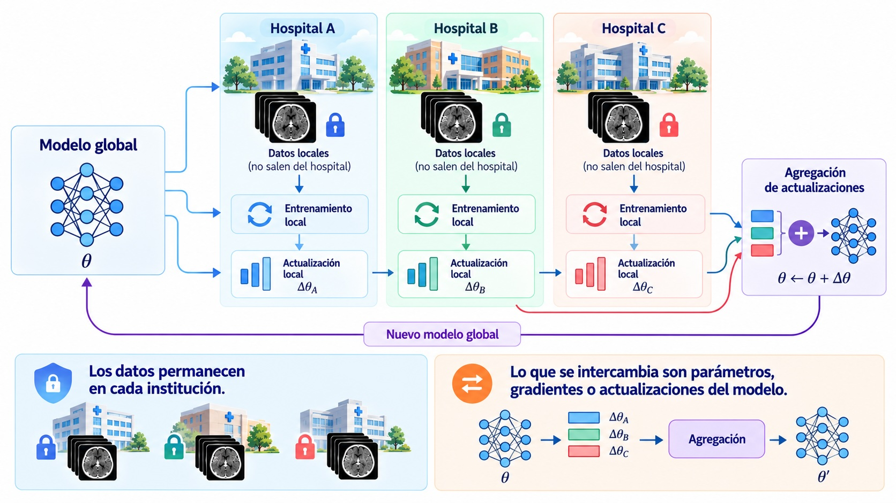{ width=80% .centered}


## ¿Qué problema intenta resolver?

Federated learning puede permitir:

- entrenar con datos multicéntricos sin reunirlos físicamente
- incorporar mayor diversidad de scanners, protocolos y poblaciones
- colaborar entre instituciones con restricciones de gobernanza de datos

Pero:

$$
\boxed{\text{Federated Learning} \neq \text{privacidad garantizada}}
$$

Persisten desafíos como:

- seguridad de las actualizaciones
- heterogeneidad entre centros
- datos **non-IID**
- tamaños de muestra muy diferentes
- distinta prevalencia y calidad de etiquetas


## Federated training no es validación externa

Supongamos que entrenamos federadamente con:

$$
A+B+C \rightarrow \text{modelo federado}
$$

¿Evaluar el modelo en A, B y C constituye validación externa?

::: {.fragment}
**No.** Esos centros participaron en el desarrollo.
:::

Una evaluación más fuerte sería:

$$
\boxed{
A+B+C \rightarrow \text{entrenamiento federado}
}
$$

$$
\boxed{
D \rightarrow \text{validación externa}
}
$$

::: {.fragment}
> Aprender de múltiples centros puede mejorar la robustez, pero no elimina la necesidad de validación independiente.
:::


## Validación temporal

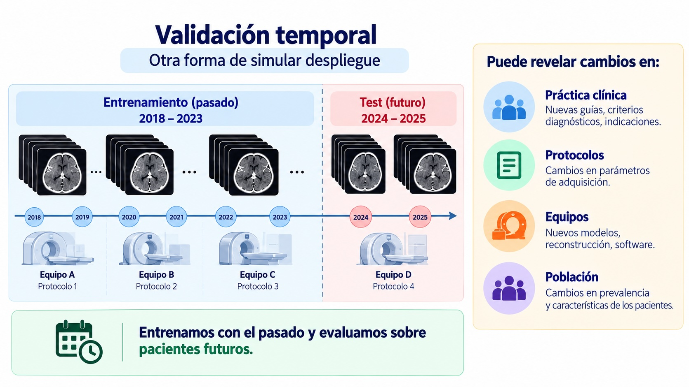{ width=80% .centered}


## Retrospectivo vs prospectivo

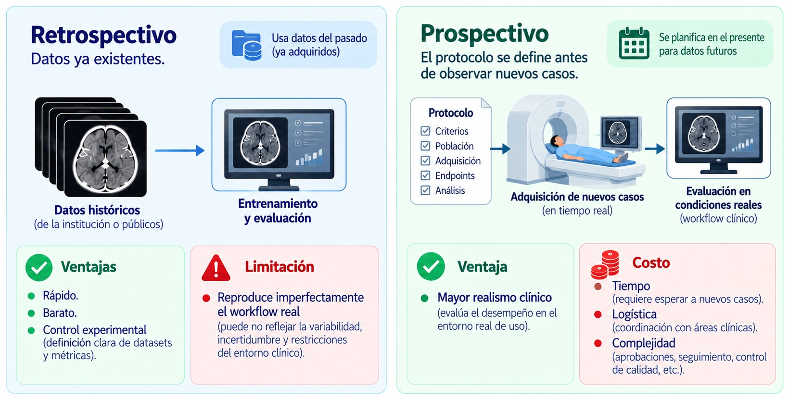{ width=80% .centered}


# 3. ¿Mejora al profesional?

## AUC = 0.95… ¿y ahora?

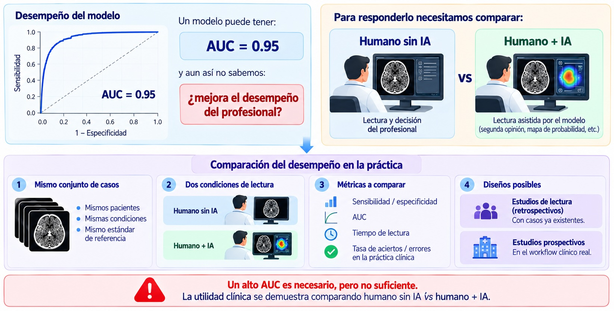{ width=80% .centered}


## Un diseño más realista

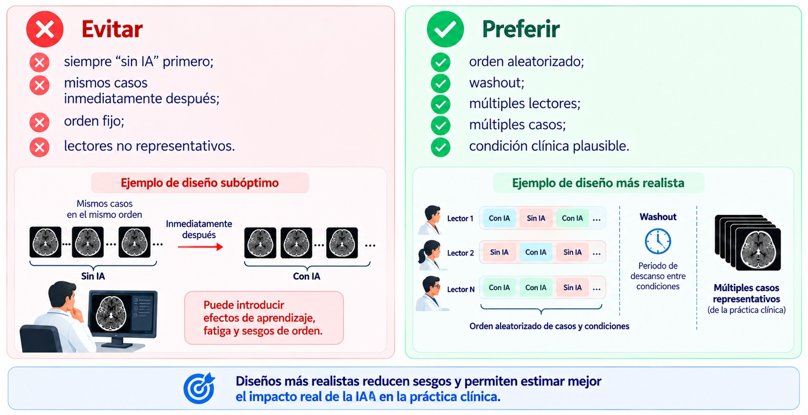{ width=80% .centered}


## Una paradoja posible ¿Cómo puede ocurrir?

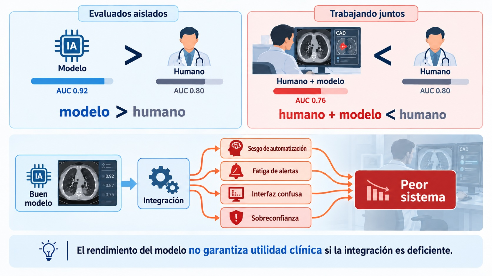{ width=80% .centered}


## Idea clave

$$
\boxed{
\text{desempeño humano–IA}
\text{ no se deduce }
\text{del desempeño del modelo aislado}
}
$$

## ¿Qué pregunta responde cada diseño?

| Diseño | Pregunta |
|--- |---|
| Test interno | ¿Generaliza dentro de mi cohorte? |
| Externo | ¿Generaliza a otro dominio? |
| Temporal | ¿Generaliza hacia el futuro? |
| Prospectivo | ¿Funciona cuando se despliega bajo protocolo real? |
| Reader study | ¿Mejora al profesional? |


# 4. Datasets: el benchmark no es el hospital

## El benchmark no es el hospital

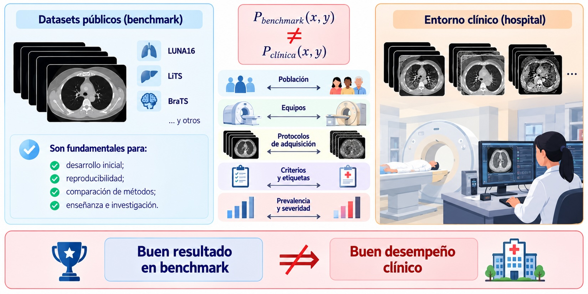{ width=80% .centered}


## Antes de usar un dataset

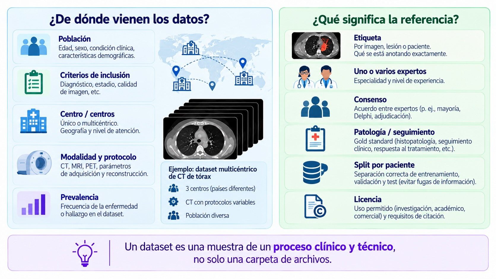{ width=80% .centered}

## Las etiquetas también tienen incertidumbre

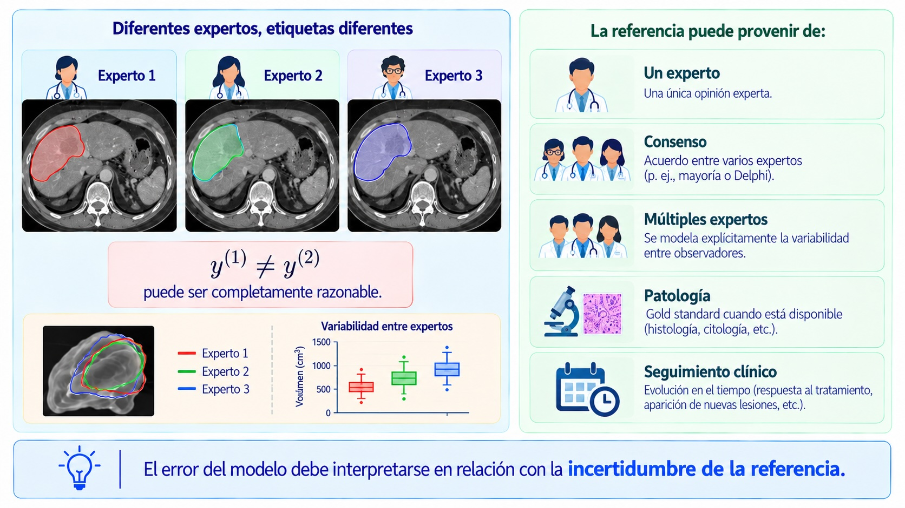{ width=80% .centered}


## Algunos datasets 

| Dataset | Modalidad | Anotación / uso típico |
|---|---|---|
| CheXpert / MIMIC-CXR | RX | clasificación; etiquetas derivadas de reportes |
| VinDr-CXR | RX | detección; bounding boxes |
| LIDC-IDRI | CT | nódulos; múltiples lectores |
| BraTS | MRI | segmentación de tumor cerebral |
| KiTS | CT | segmentación de riñón / tumor |
| TCIA | varias | colecciones oncológicas heterogéneas |

::: {.fragment}
No necesitamos memorizar la lista. Lo importante es preguntar:

$$
\boxed{\text{¿este dataset representa la pregunta clínica que quiero estudiar?}}
$$
:::


# 5. Integración conceptual de la unidad

## De la imagen al sistema clínico

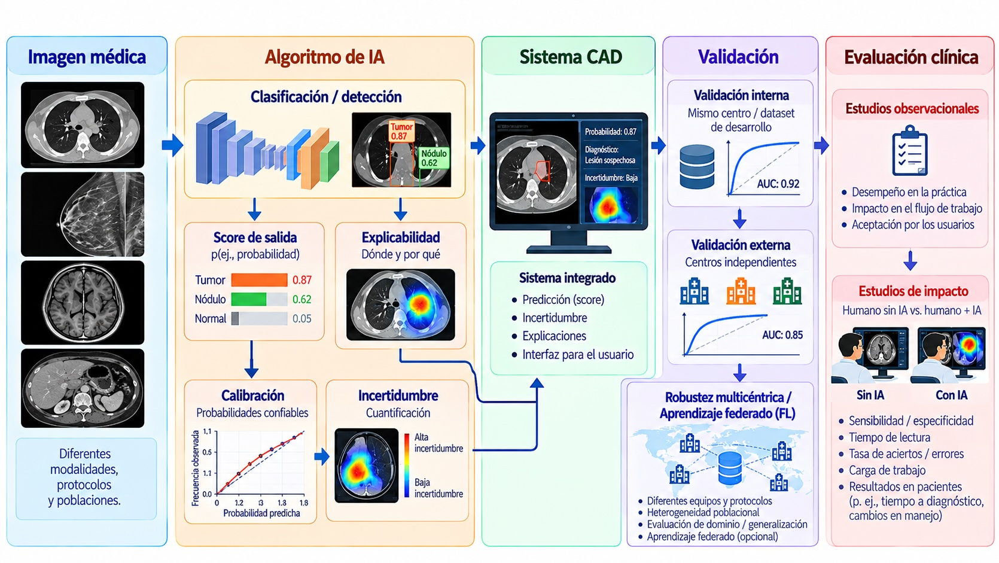{ width=80% .centered}

## La pregunta fue cambiando

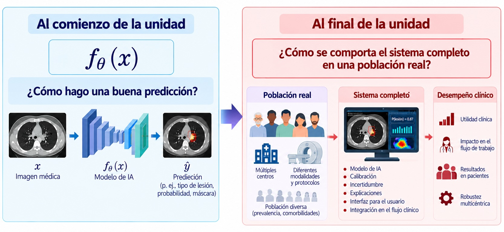{ width=80% .centered}


## Cinco niveles que no debemos confundir

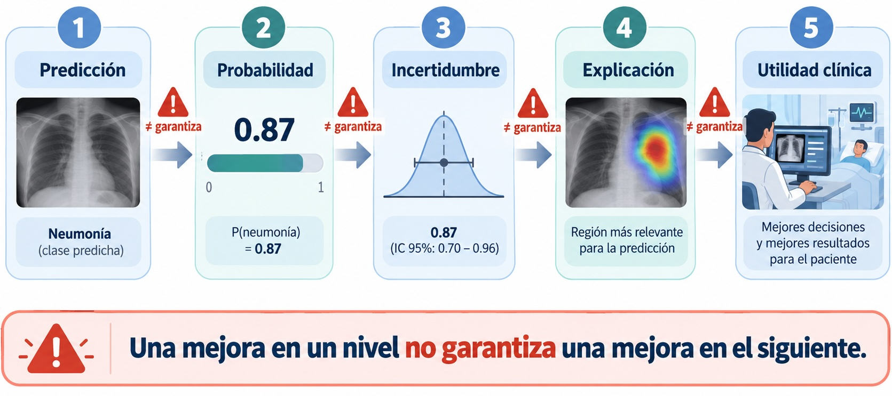{ width=80% .centered}

## Qué debería informar un estudio serio

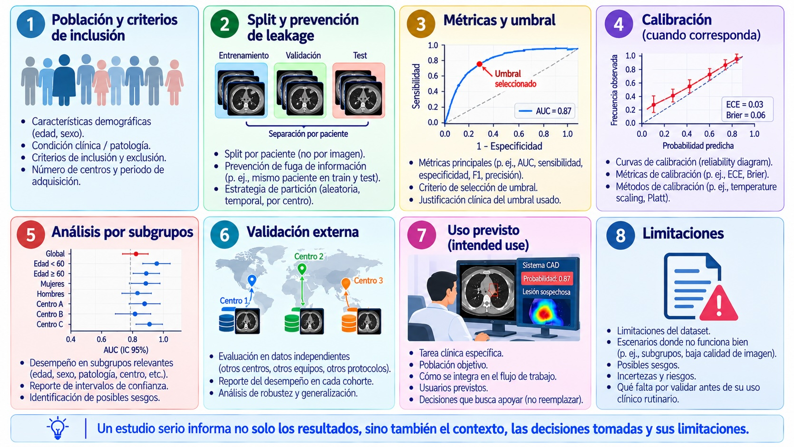{ width=80% .centered}

## Checklist antes de confiar en un resultado

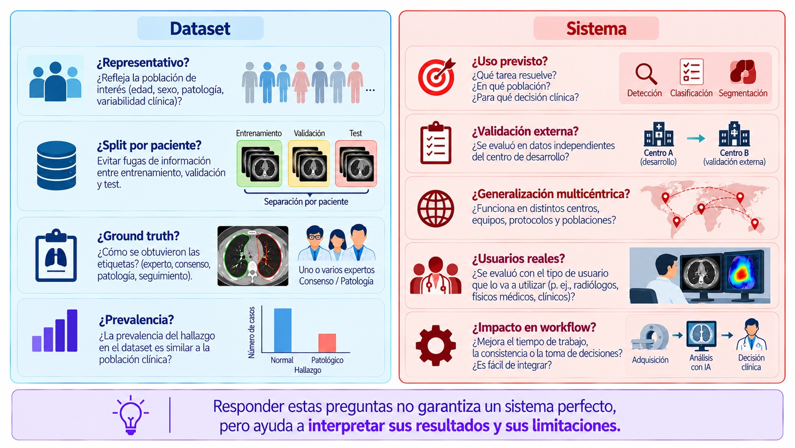{ width=80% .centered}


## Cierre de la unidad

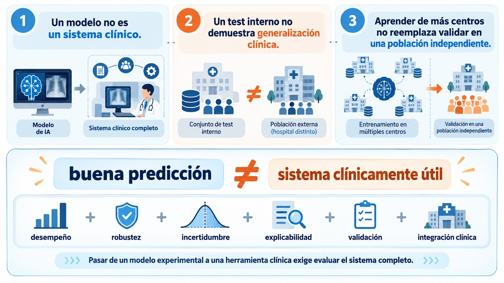{ width=80% .centered}
