## ¿Cómo convertir ruido aleatorio en una CT plausible? {.centered}

Del proceso directo de corrupción a una representación comprimida de la imagen.

## Objetivos de la clase

Al finalizar podremos:

1. Explicar los procesos **directo** e **inverso** de difusión.
2. Construir matemáticamente una imagen ruidosa $x_t$.
3. Describir cómo se entrena una red para **predecir ruido**.
4. Diferenciar **entrenamiento** y **generación iterativa**.
5. Explicar qué hace un **autoencoder** y por qué interesa comprimir imágenes 3D.

## La pregunta que dejó la clase 1

En una GAN, generar una imagen suele requerir una sola evaluación:

$$z\sim p(z)\quad\longrightarrow\quad \hat{x}=G_\theta(z)$$

Pero discutimos dificultades de:

- Estabilidad del entrenamiento adversarial
- Cobertura de la distribución (*mode collapse*)
- Costo y coherencia de los volúmenes 3D

**¿Podemos aprender a generar imágenes sin enfrentar un generador y un discriminador?**

## Una estrategia distinta: empezar por el ruido

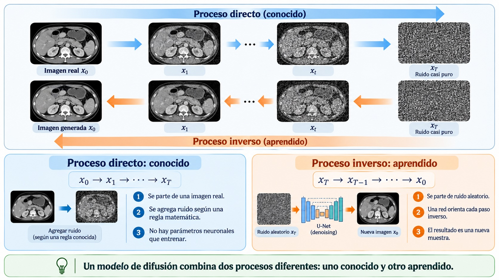{ width=80% .centered}

# I · ¿Cómo se corrompe una imagen? {.section-slide}

**El proceso directo (*forward diffusion*)**

## De una CT a ruido casi puro

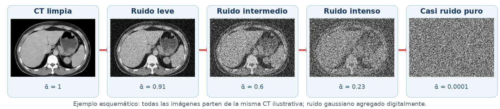{ width=80% .centered}

- Partimos de una CT representada numéricamente como $x_0$
- El mismo estudio pierde estructura reconocible al aumentar el nivel de ruido
- La corrupción es artificial: **no representa necesariamente el ruido de adquisición de un tomógrafo**

## La regla matemática de un paso

Una transición de un modelos probabilísticos de difusión con eliminación de ruido (DDPM) convencional puede escribirse:

$$
\boxed{q(x_t\mid x_{t-1})=
\mathcal N\!\left(\sqrt{1-\beta_t}\,x_{t-1},\;\beta_t I\right)}
$$

- $x_{t-1}$: imagen del paso anterior.
- $\beta_t$: varianza del ruido incorporado en el paso $t$.
- $I$: covarianza identidad en esta formulación.

**La distribución $q$ se especifica antes del entrenamiento.**

## Comparació entre las GAN y la DDPM

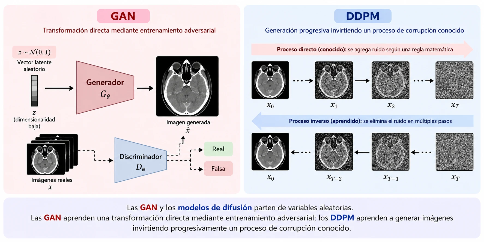{ width=80% .centered}

## Una muestra de ese paso

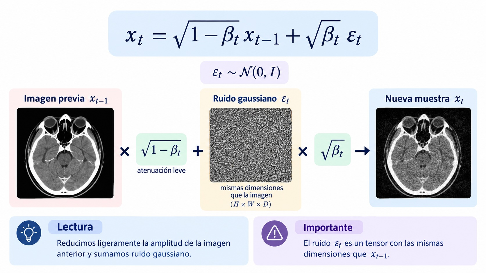{ width=80% .centered}

## ¿Quién decide cuánto ruido se agrega?

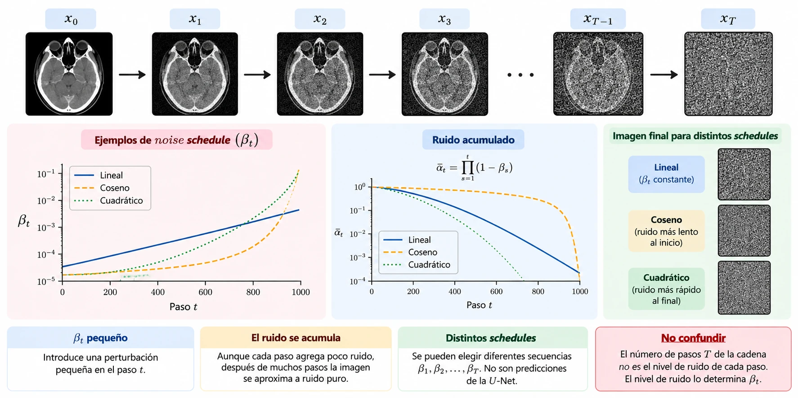{ width=80% .centered}

## Tres parámetros, tres papeles

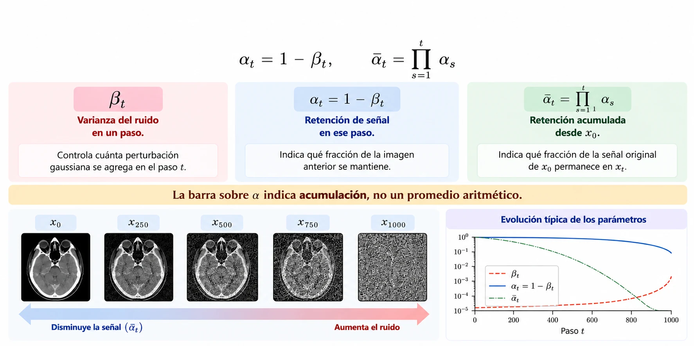{ width=80% .centered}

## De muchos pasos a una sola ecuación

Podemos generar directamente el estado correspondiente a cualquier tiempo $t$:

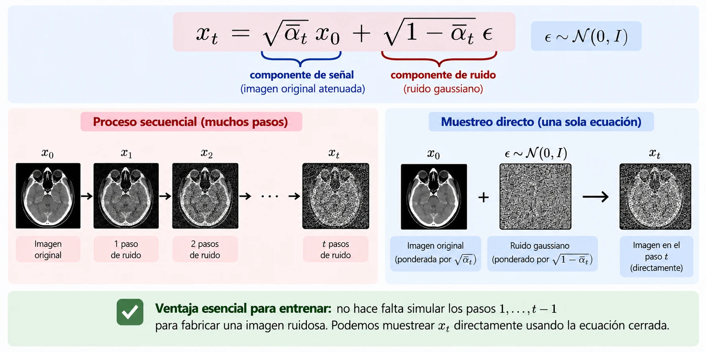{ width=80% .centered}

## Ejemplo numérico: ¿qué significa $\bar\alpha_t=0.36$?

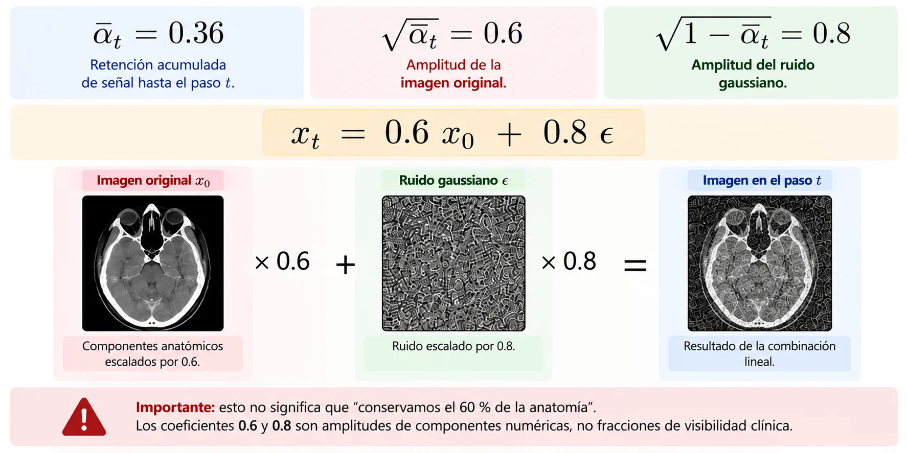{ width=80% .centered}

## ¿Por qué $x_T$ termina pareciéndose a ruido?

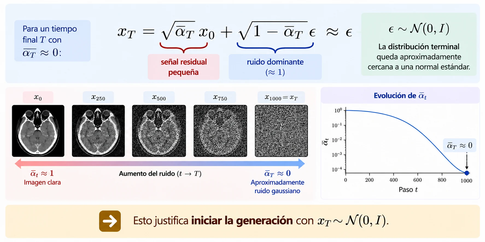{ width=80% .centered}

## Precisión necesaria en Física Médica

El ruido se aplica sobre **intensidades normalizadas** para la red, no sobre unidades físicas de CT o MRI.

- En CT, el escalado de HU debe estar bien documentado
- En MRI, las intensidades no tienen una escala absoluta universal
- La corrupción sintética no modela automáticamente la física del escáner

**Plausibilidad visual y fidelidad cuantitativa son criterios diferentes.**

# II · Aprender a eliminar ruido {.section-slide}

**El *denoiser* como problema de aprendizaje supervisado**

## La dirección inversa no está dada

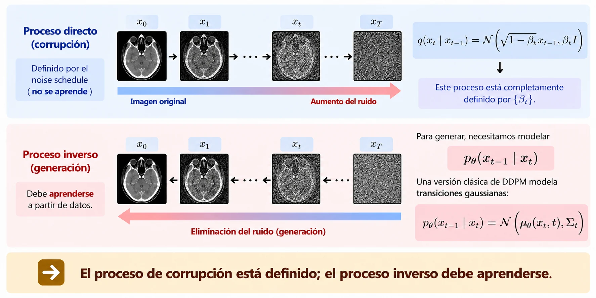{ width=80% .centered}

## La idea clave: conocemos el ruido que agregamos

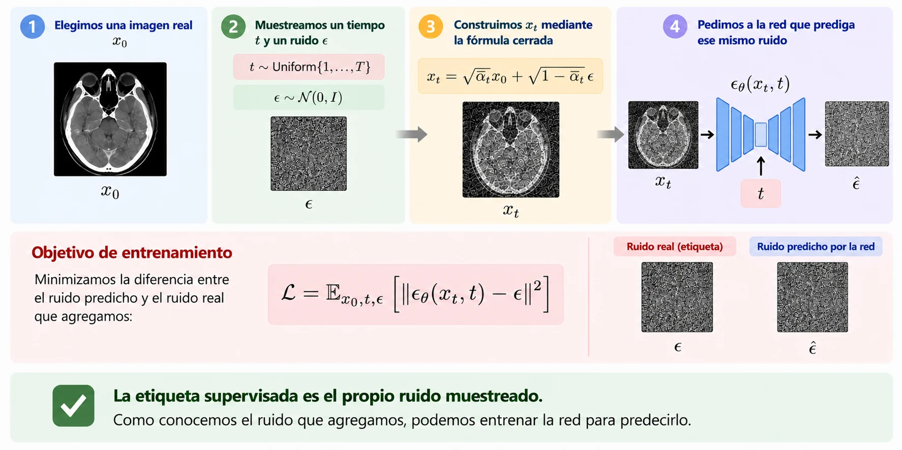{ width=80% .centered}

## Una U-Net, pero no para segmentar

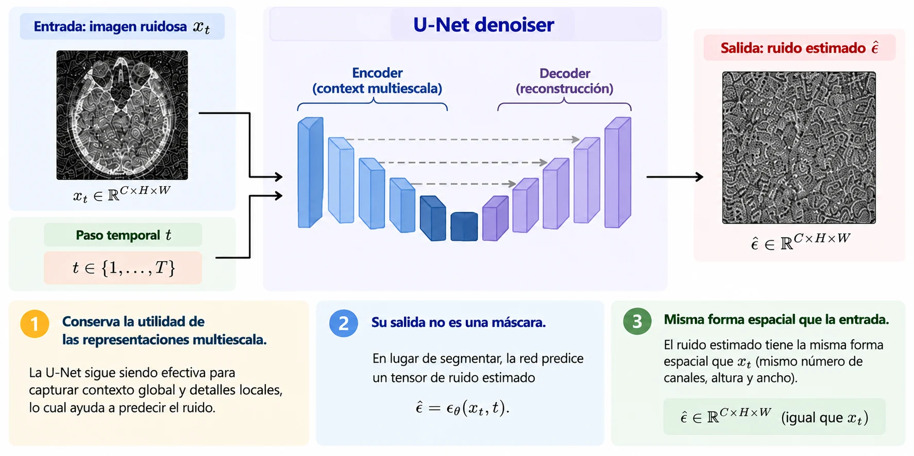{ width=80% .centered}

## ¿Por qué también recibe el tiempo $t$?

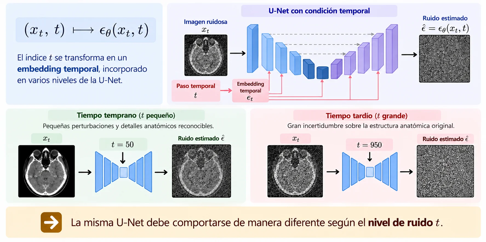{ width=80% .centered}

## La función de pérdida DDPM simplificada

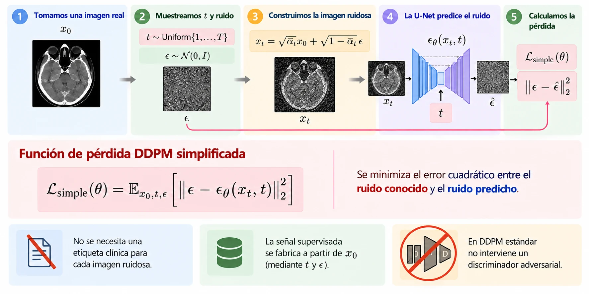{ width=80% .centered}

## Una iteración completa de entrenamiento

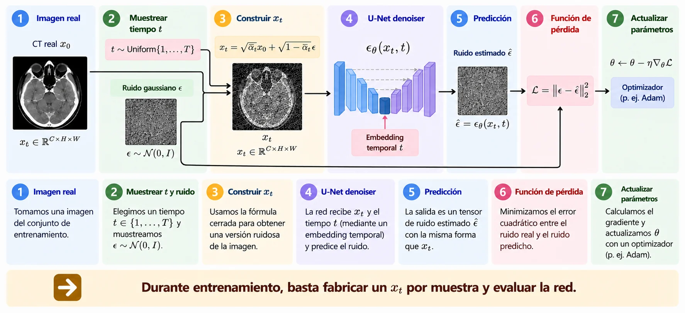{ width=80% .centered}

## Un error menor no equivale a una CT mejor

La pérdida sobre ruido indica si la red realiza bien **su tarea de predicción**.

Pero la calidad de una CT generada depende además de:

- El muestreador y su cantidad de pasos
- La distribución de entrenamiento
- La reconstrucción de detalles anatómicos pequeños
- La calibración de intensidades y la diversidad de muestras

**La MSE de ruido no sustituye una validación clínica o dosimétrica.**

## Una imagen limpia estimada a partir de $x_t$

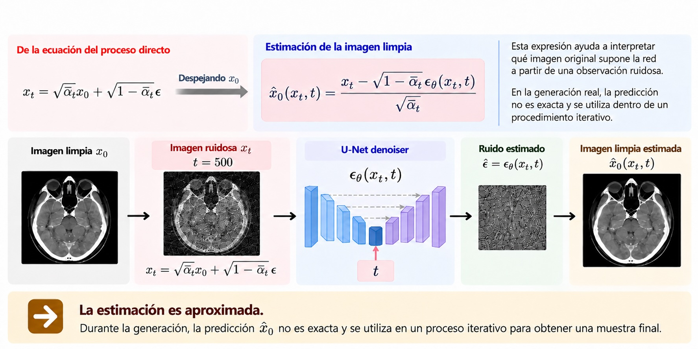{ width=80% .centered}

## Visualizar el mecanismo completo

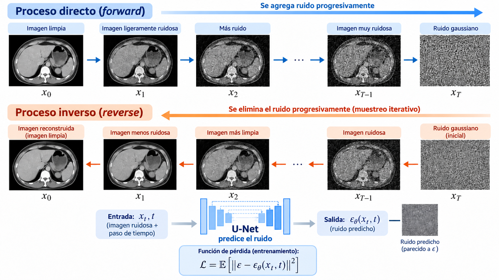{ width=80% .centered}

**El *forward* fabrica ejemplos; la red aprende a estimar ruido; el muestreador utiliza esa estimación en sentido inverso.**

## Pausa práctica 1: ¿cómo aprende un DDPM?

**Notebook:** `01_ddpm_2d_fundamentos.ipynb`

Vamos a conectar las ecuaciones con su implementación en MONAI.

### ¿Qué vamos a observar?

- Cómo se construye $x_t$ agregando ruido a $x_0$.
- Cómo se selecciona aleatoriamente el timestep $t$.
- Cómo la red predice $\epsilon_\theta(x_t,t)$.
- Cómo se calcula la pérdida MSE.
- Cómo se genera una imagen a partir de ruido.

::: {.callout-note}
**Pregunta guía:** ¿qué aprende realmente la red y cómo utilizamos ese aprendizaje para generar una imagen nueva?
:::

# III · Generar una imagen nueva {.section-slide}

**¿Cómo se utiliza el modelo ya entrenado?**

## En inferencia no partimos de una CT de un paciente

$$\boxed{x_T\sim\mathcal N(0,I)}$$

- $x_T$ es un tensor de ruido de la **forma espacial de la imagen** que queremos generar.
- No es necesariamente el vector latente pequeño $z$ de una GAN convencional.
- La red $\epsilon_\theta$ conserva sus parámetros: **no se actualiza durante el muestreo**.

## El proceso inverso es una secuencia

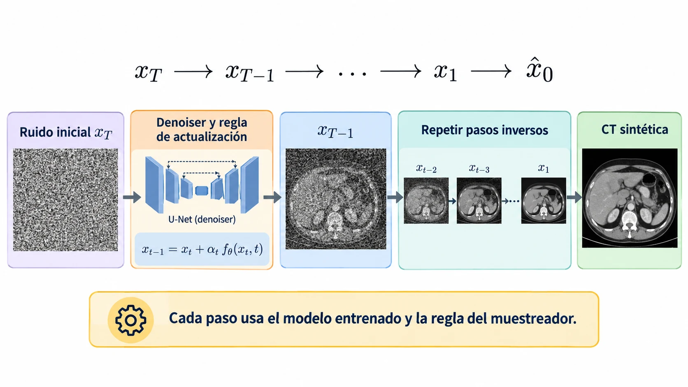{ width=80% .centered}

## ¿Qué hace un paso inverso de DDPM?

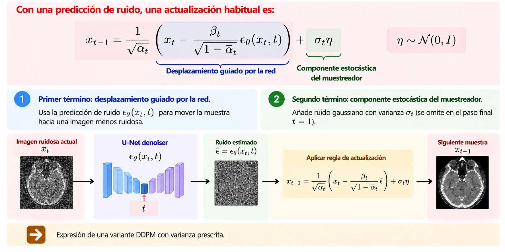{ width=80% .centered}

## No es simplemente «restar ruido»

La red estima una cantidad que permite construir **una distribución de transición** hacia un estado menos ruidoso.

- La estimación $\epsilon_\theta$ puede ser imperfecta
- Los pasos anteriores influyen en los siguientes
- Algunas estrategias son estocásticas; otras pueden ser deterministas
- 
**Una buena intuición es «corrección iterativa», no inversión exacta de un ruido conocido.**

## Entrenamiento e inferencia son diferentes

| Entrenamiento | Generación |
|:---|:---|
| CT real $x_0$ disponible | Parte de ruido $x_T$ |
| Elegimos $t$ al azar | Recorremos tiempos decrecientes |
| Conocemos $\epsilon$ | Estimamos $\epsilon_\theta$ |
| Ajustamos los parámetros | Parámetros congelados |
| Un paso de red por muestra | Múltiples evaluaciones |

**La misma red sirve en dos flujos computacionales distintos.**

## DDPM y DDIM: modelo frente a muestreador

- **DDPM:** una construcción habitual del muestreo inverso, generalmente estocástica.
- **DDIM:** otro procedimiento de muestreo que puede ser determinista y utilizar menos pasos.
- Los pasos utilizados en inferencia pueden diferir de los tiempos considerados durante entrenamiento.

**La arquitectura del *denoiser* y el algoritmo de muestreo no son la misma decisión.**

## ¿Por qué la generación puede ser lenta?

Si una evaluación del *denoiser* cuesta $\tau$:

$$
T_{\mathrm{muestra}}\approx
N_{\mathrm{evaluaciones}}\,\tau+T_{\mathrm{otros}}
$$

**GAN convencional:** típicamente una pasada por el generador.

**Difusión clásica:** múltiples evaluaciones de un modelo, potencialmente costosas en 3D.

La cantidad de pasos es un compromiso entre **tiempo, calidad y diversidad**.

## Dos estrategias generativas, no un ganador universal

| Aspecto | GAN | Difusión clásica |
|:---|:---|:---|
| Entrenamiento | Competencia adversarial | Predicción supervisada de ruido |
| Generación | Una evaluación del generador | Pasos iterativos |
| Dificultad frecuente | Estabilidad y cobertura | Costo de inferencia |
| Discriminador | Sí, en la GAN estándar | No, en DDPM estándar |

La comparación debe hacerse sobre una **tarea clínica concreta** y un protocolo común de evaluación.

## Pausa práctica 2: ¿podemos generar en menos pasos?

**Notebook:** `02_ddpm_vs_ddim.ipynb`

Utilizaremos el mismo modelo entrenado y compararemos diferentes estrategias de muestreo.

### ¿Qué vamos a comparar?

- **DDPM:** muestreo estocástico.
- **DDIM:** muestreo que puede realizarse con menos pasos.
- Diferentes cantidades de pasos de inferencia.
- Tiempo de generación y diferencias visuales.

::: {.callout-note}
**Pregunta guía:** ¿cuántos pasos podemos reducir antes de observar diferencias importantes en las imágenes?
:::

# IV · Difusión para Física Médica {.section-slide}

**¿Qué cambia cuando queremos una CT o MRI 3D?**

---

## El costo 3D aparece en cada paso inverso

En la clase 1 vimos cómo aumenta el número de elementos de $512^2$ a $512^3$.

La difusión introduce además una dimensión computacional:

$$
\boxed{\text{Costo de procesar un volumen}
\;\times\;\text{número de evaluaciones}}
$$

La memoria total de entrenamiento incluye también **activaciones, gradientes y estados del optimizador**.

## Pausa práctica 3: ¿qué cambia cuando generamos en 3D?

**Notebook:** `03_ddpm_3d_volumenes.ipynb`

Pasaremos de generar imágenes 2D a trabajar con volúmenes completos.

### ¿Qué vamos a observar?

- Tensores 2D: $(B,C,H,W)$.
- Tensores 3D: $(B,C,H,W,D)$.
- Una U-Net de difusión con `spatial_dims=3`.
- Visualización axial, coronal y sagital.
- Costo computacional y coherencia espacial.

::: {.callout-note}
**Pregunta guía:** ¿por qué generar un volumen anatómicamente coherente es más difícil que generar cortes independientes?
:::

## Generación libre frente a generación condicionada

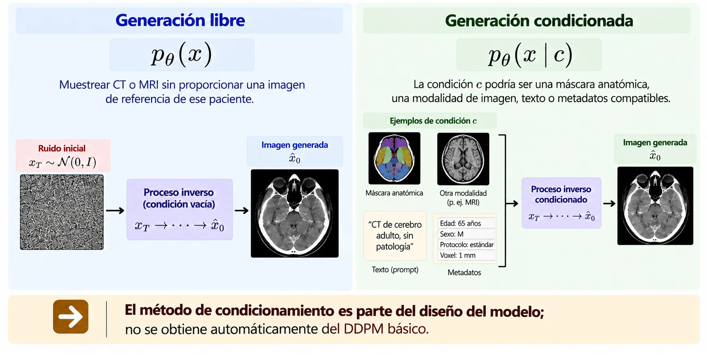{ width=80% .centered}

## Una CT convincente no es una CT validada

Para uso en Física Médica pueden ser relevantes:

- Coherencia axial, coronal y sagital; ausencia de artefactos 3D
- Intensidades y distribución de **HU**
- Presencia y representación de órganos pequeños o patologías infrecuentes
- Errores relevantes para segmentación, registro y dosimetría
- Diversidad y ausencia de copias de pacientes del entrenamiento

**La validación debe depender del uso final, no solo de una métrica visual.**

## ¿Por qué pensar en una representación comprimida?

El modelo de difusión anterior trabaja directamente con un tensor del tamaño de la imagen.

En una CT 3D esto implica mucho cálculo, repetido muchas veces.

**Pregunta:** ¿podemos aprender a conservar la información importante en un tensor más pequeño?

Esta pregunta conduce a los **autoencoders**.

# V · Autoencoders: aprender a comprimir {.section-slide}

**De los datos al espacio latente**

## ¿Qué hace un autoencoder?

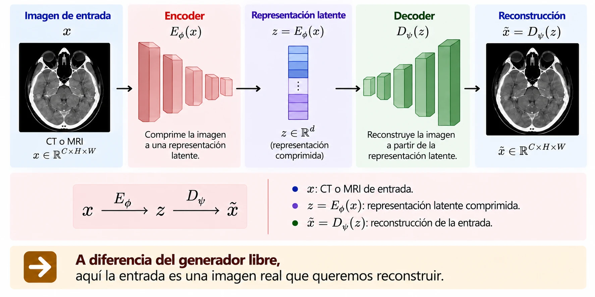{ width=80% .centered}

## Una arquitectura encoder–decoder

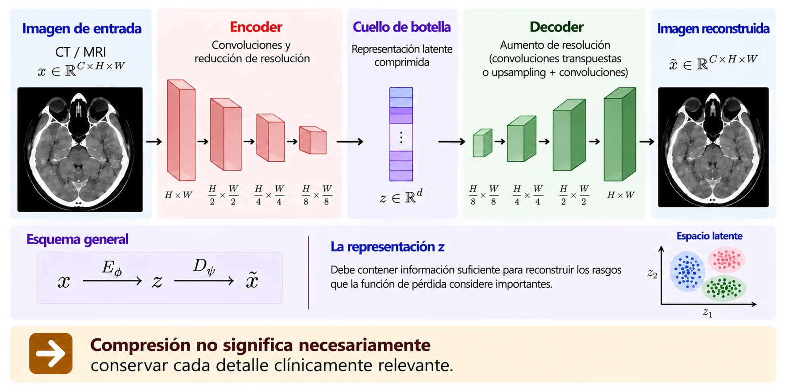{ width=80% .centered}

## ¿Qué significa «espacio latente»?

Es el espacio de representaciones posibles $z=E_\phi(x)$.

::: {.columns}
::: {.column width="47%"}
### Espacio de imagen

- Muchísimos píxeles o vóxeles
- Estructura espacial explícita
- Alto costo computacional
:::
::: {.column width="47%"}
### Espacio latente

- Menor número de valores
- Rasgos codificados por la red
- Se reconstruye mediante el decoder
:::
:::

**Sus coordenadas no tienen por qué corresponder directamente a órganos o atributos anatómicos.**

## Ejemplo: ¿cuánto se comprime un volumen?

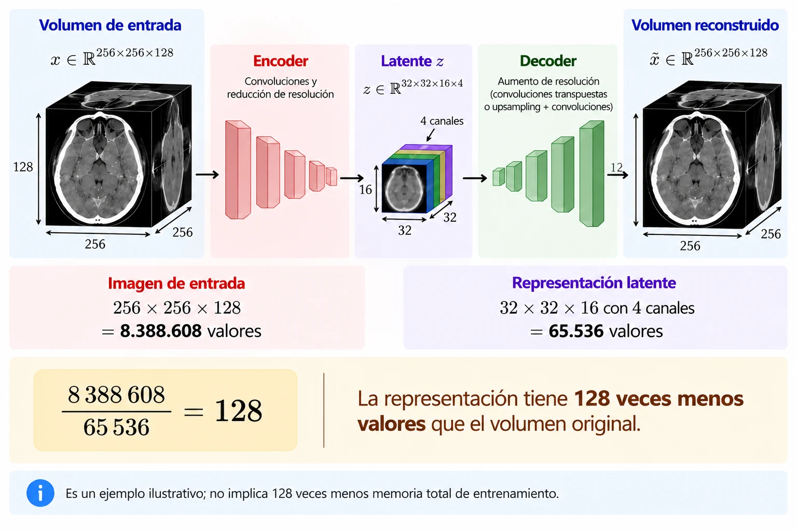{ width=80% .centered}

## ¿Cómo aprende a reconstruir?

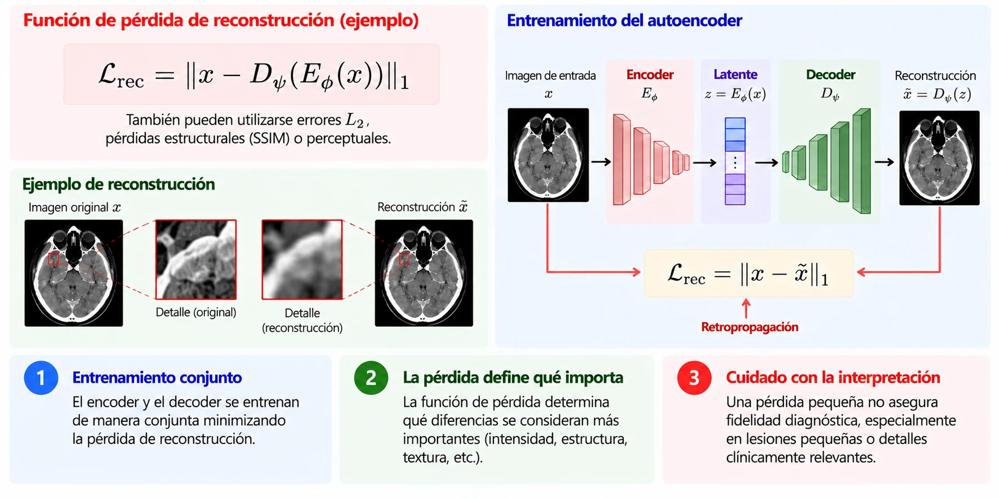{ width=80% .centered}

## Reconstrucción no es generación libre

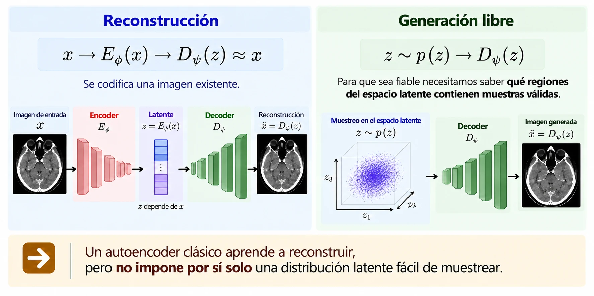{ width=80% .centered}

## Una limitación relevante para CT y MRI

Si el encoder elimina detalles que el decoder no puede recuperar, podemos obtener:

- Bordes anatómicos suavizados
- Desaparición de lesiones pequeñas
- Errores locales de intensidad o textura
- Reconstrucciones aceptables visualmente, pero inadecuadas para una tarea cuantitativa

**La compresión debe validarse con criterios asociados al uso clínico.**

## Del autoencoder a la difusión latente

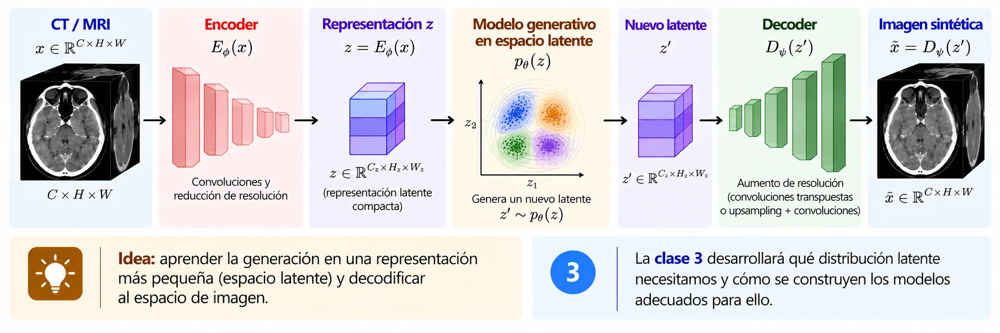{ width=80% .centered}

## ¿Qué falta en un autoencoder clásico?

Un encoder convencional puede organizar los ejemplos en regiones difíciles de muestrear.

Si elegimos arbitrariamente $z\sim\mathcal N(0,I)$, **no está garantizado** que $D_\psi(z)$ produzca una imagen válida.

**Próxima clase:** autoencoders variacionales, regularización KL, AutoencoderKL y difusión latente.

## Volvamos a la pregunta inicial

**¿Cómo convertir ruido aleatorio en una CT plausible?**

1. Definimos una corrupción conocida $q(x_t\mid x_{t-1})$.
2. Entrenamos una red para estimar el ruido $\epsilon_\theta(x_t,t)$.
3. Aplicamos un muestreador inverso desde $x_T\sim\mathcal N(0,I)$.

$$
\boxed{\text{Predicción de ruido} +
\text{muestreo iterativo}\Rightarrow\text{síntesis}}
$$

La compresión mediante autoencoders abre la posibilidad de **reducir el costo del proceso generativo**.
