## La pregunta de hoy

**¿Cómo generar imágenes médicas sin aplicar la difusión directamente sobre millones de vóxeles?**

Ya conocemos dos componentes:

- Una red capaz de **aprender a eliminar ruido**.
- Un modelo capaz de **comprimir y reconstruir imágenes**.

**Hoy aprenderemos a combinarlos.**

## Dos herramientas de la clase anterior

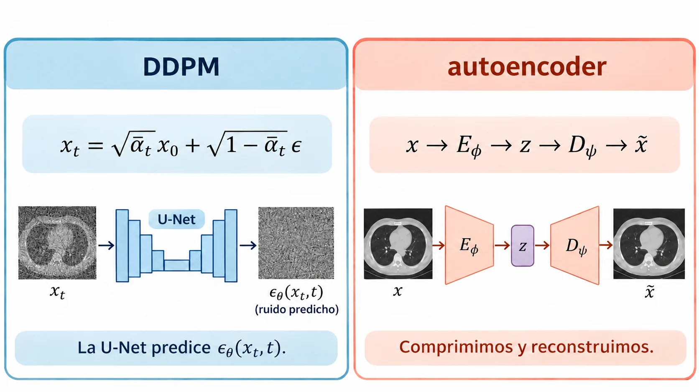{ width=80% .centered}

## Ruta de la clase

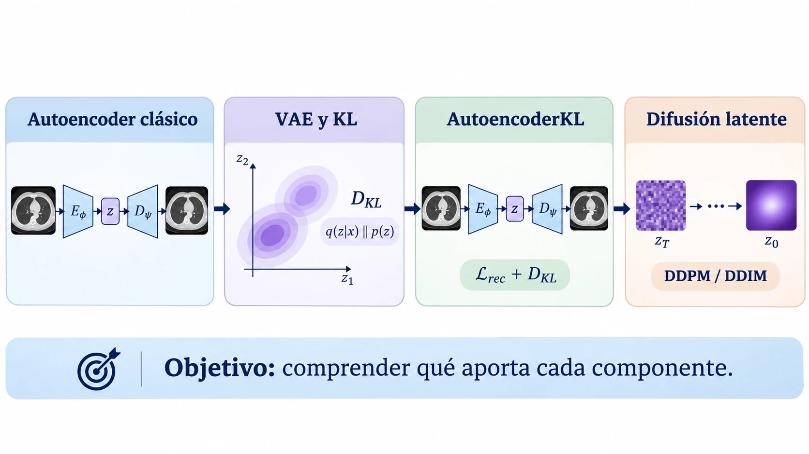{ width=80% .centered}

## Bloque I · El problema del espacio latente

**Un autoencoder puede reconstruir bien y aun así no ser un generador libre.**

La pregunta de este bloque es: **¿qué ocurre al elegir un vector latente que el decoder nunca ha visto?**

## Reconstruir no es generar libremente

{ width=80% .centered}

## ¿Dónde se concentran los vectores latentes?

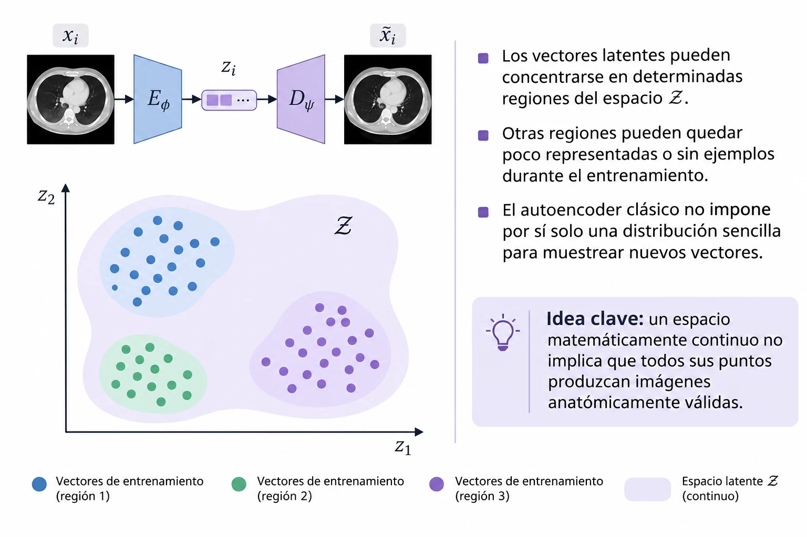{ width=80% .centered}

## ¿Y si elegimos un vector nuevo?

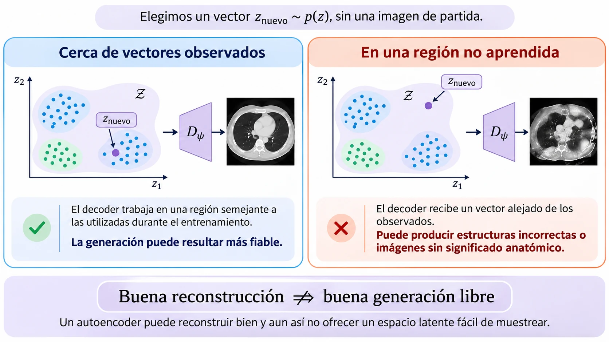{ width=80% .centered}

## ¿Qué necesitamos de una representación latente?

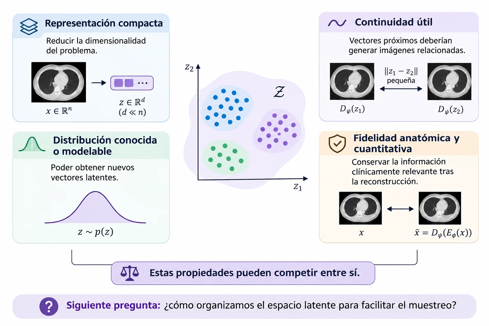{ width=80% .centered}

## Bloque II · Variational Autoencoder (VAE)

**De un vector determinista a una distribución condicionada a la imagen.**

## Encoder clásico frente a encoder de un VAE

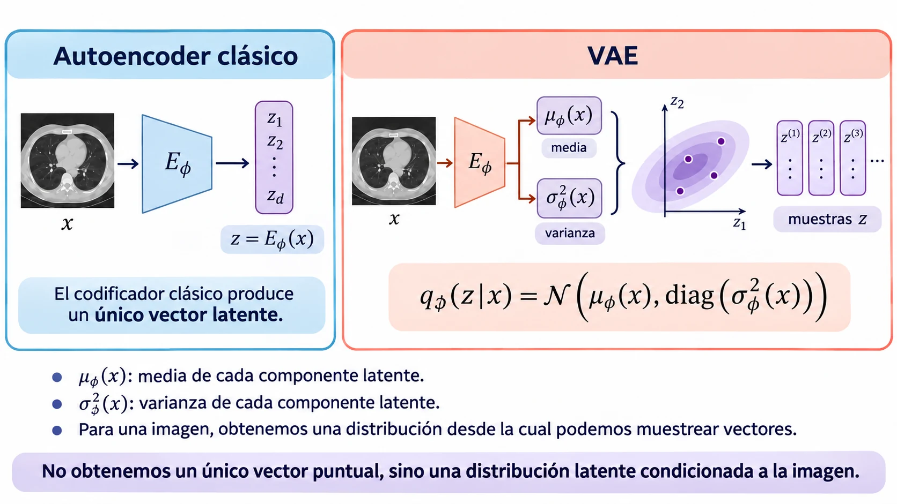{ width=80% .centered}

## ¿Qué representa el ruido $\epsilon$?

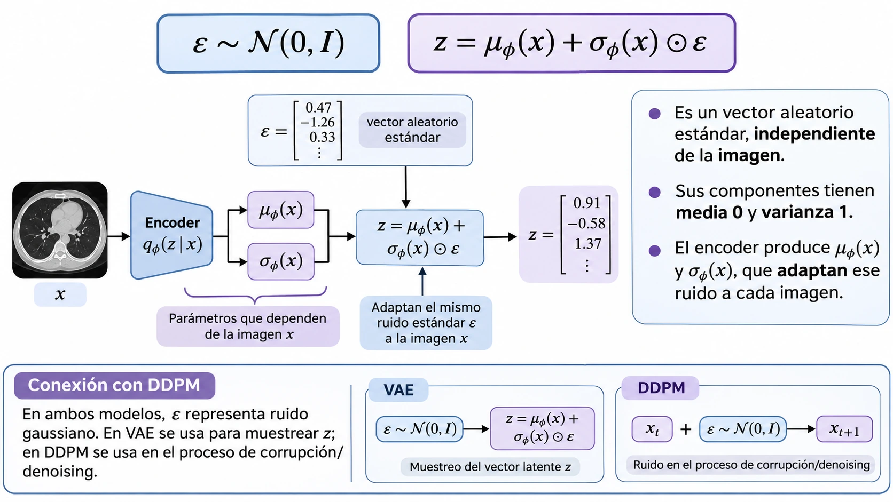{ width=80% .centered}

## De una distribución a un vector latente

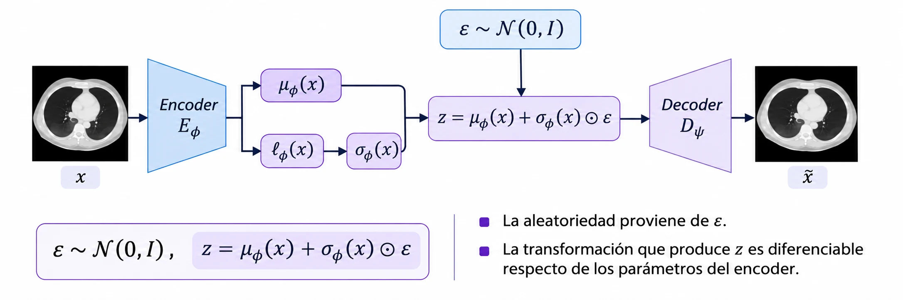{ width=80% .centered}

**Idea central:** la aleatoriedad está en $\epsilon$; la transformación de $\mu_\phi(x)$ y $\sigma_\phi(x)$ a $z$ permite retropropagar gradientes.

## Si muestreamos al azar, ¿cómo reconstruimos?

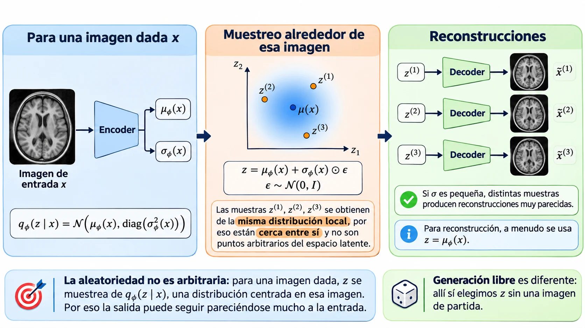{height="490px" fig-align="center"}

## Dos formas diferentes de obtener $z$

{ width=80% .centered}

## ¿Por qué aparece la regularización?

Un autoencoder puede minimizar su error de reconstrucción **sin organizar las representaciones** para que puedan muestrearse fácilmente.

Queremos simultáneamente:

- Conservar la información de cada MRI o CT
- Evitar que las distribuciones condicionadas queden arbitrariamente dispersas

**¿Con qué distribución podríamos compararlas?**

## Elegimos una distribución de referencia

$$\boxed{p(z)=\mathcal N(0,I)}$$

- Es sencilla de muestrear y tiene una densidad conocida.
- El VAE utiliza esta referencia como **prior de regularización**.
- No significa que todas las distribuciones $q_\phi(z\mid x)$ sean idénticas a $p(z)$.

**Objetivo:** favorecer compatibilidad con el prior, sin perder información necesaria para reconstruir.

## Divergencia KL: ¿qué mide?

$$
D_{\mathrm{KL}}\!\left(q_\phi(z\mid x)\,\Vert\,p(z)\right)
$$

- Penaliza diferencias entre la distribución condicionada y el prior.
- Es **no negativa** y, en general, **no es simétrica**.
- Disminuir la KL favorece la regularización, **pero no garantiza imágenes anatómicamente correctas**.

**Intuición:** si el encoder intenta utilizar distribuciones muy alejadas del prior, pagará una penalización.

## Dos objetivos que compiten

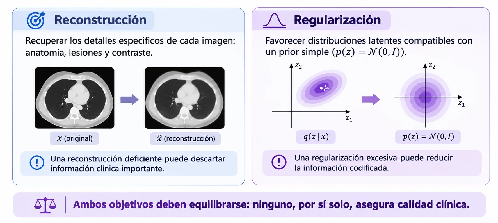{ width=80% .centered}

## La pérdida utilizada para entrenar

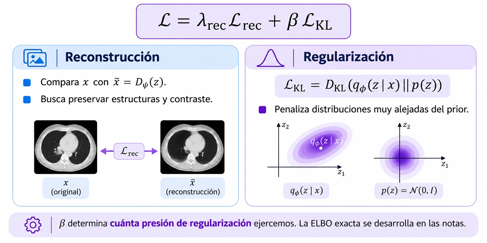{ width=80% .centered}

## ¿Cómo se entrena un VAE?

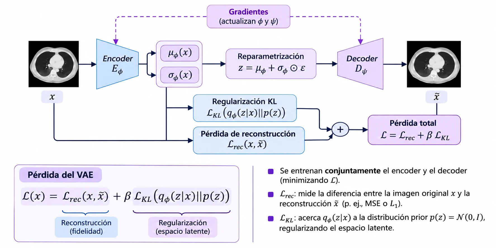{ width=80% .centered}

## Una iteración en PyTorch: ¿qué se actualiza?

### Forward y cálculo de la pérdida

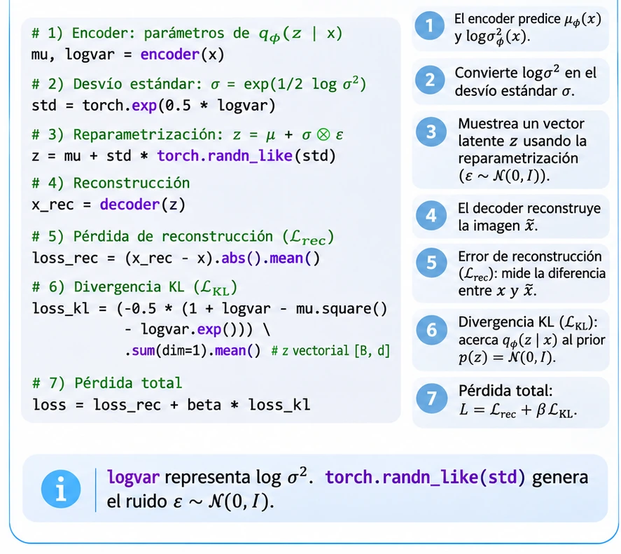{ width=80% .centered}

## Una iteración en PyTorch: ¿qué se actualiza?

### Backpropagation y actualización de pesos

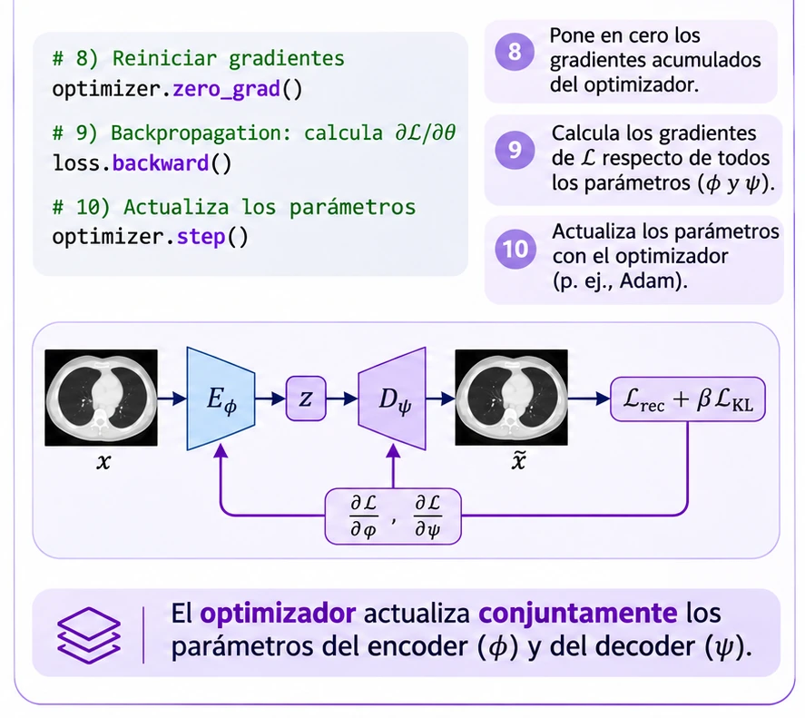{ width=80% .centered}

## ¿Qué ocurre si variamos $\beta$?

| Peso de KL | Tendencia | Posible problema |
|---|---|---|
| Pequeño | Mejora relativa de reconstrucción | Distribuciones difíciles de muestrear |
| Grande | Mayor presión hacia el prior | Pérdida de información, colapso posterior |
| Intermedio | Compromiso ajustable | Depende de arquitectura y datos |

**No existe un $\beta$ universal.**

## ¿Y si desaparece una lesión pequeña?

Imaginemos que la MRI reconstruida conserva la anatomía global, pero elimina una lesión de pocos milímetros.

- Un MAE o SSIM global podría seguir siendo bueno
- Para la tarea clínica, el autoencoder podría resultar **inaceptable**

**La fidelidad diagnóstica no se deduce de una pérdida global pequeña.**

## Bloque III · AutoencoderKL en imágenes médicas

**Usaremos representaciones latentes espaciales para trabajar con imágenes y volúmenes de alta dimensionalidad.**

## De vector latente a tensor espacial

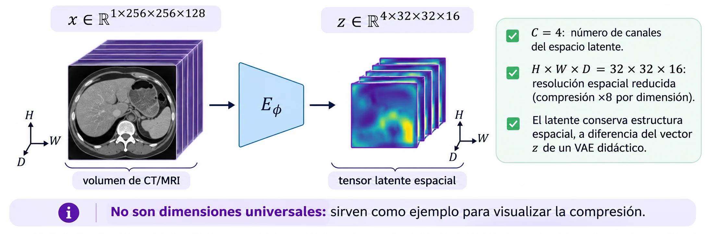{ width=80% .centered}

## ¿Cuánto comprime este volumen?

:::: {.columns}
::: {.column width="48%"}
**Imagen de entrada:**

$$256\times256\times128=8\,388\,608$$
:::
::: {.column width="48%"}
**Tensor latente (4 canales):**

$$4\times32\times32\times16=65\,536$$
:::
::::

$$\boxed{\dfrac{8\,388\,608}{65\,536}=128}$$

**128 veces menos valores no significa 128 veces menos memoria total de entrenamiento.**

## ¿Qué hace AutoencoderKL?

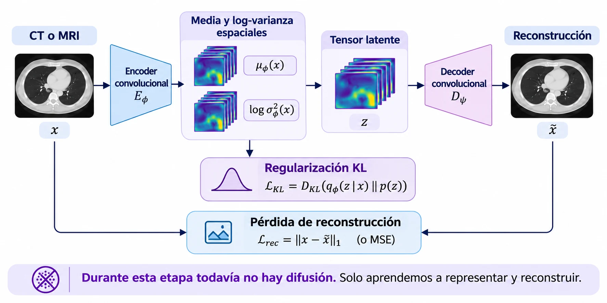{ width=80% .centered}

## ¿Por qué no alcanza con una pérdida L1?

Una implementación puede combinar:

$$
\mathcal L_{\mathrm{AE}}=\lambda_1\mathcal L_1+\lambda_{\mathrm{perc}}\mathcal L_{\mathrm{perc}}+\lambda_{\mathrm{KL}}\mathcal L_{\mathrm{KL}}+\lambda_{\mathrm{adv}}\mathcal L_{\mathrm{adv}}
$$

- $L_1$: diferencias locales de intensidad.
- Pérdida perceptual: similitud entre características; **requiere validar el dominio de la red que las extrae**.
- Término adversarial: **opcional**, puede favorecer realismo visual.

**En CT, realismo no reemplaza exactitud de HU ni validez dosimétrica.**

## El cuello de botella también es un límite

$$x\xrightarrow{E_\phi}z\xrightarrow{D_\psi}\tilde x$$

Si se pierde información al comprimir, la etapa generativa posterior **no puede garantizar recuperarla**.

¿Qué deberíamos auditar antes de entrenar un LDM?

- Bordes, estructuras pequeñas y lesiones.
- Intensidad de tejidos y valores de HU cuando corresponda.
- Consistencia entre cortes y volúmenes.

## Bloque IV · Difusión latente (LDM)

**Usar la red de difusión sobre el tensor latente, en lugar de hacerlo sobre cada vóxel de la imagen.**

## ¿Qué cambia respecto de DDPM?

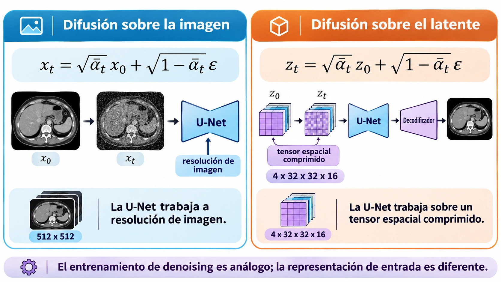{ width=80% .centered}

## ¿Por qué puede ser más eficiente?

La difusión latente reduce la resolución espacial que procesa la U-Net.

Pero el costo también depende de:

- Canales del tensor latente y arquitectura de la U-Net.
- Atención, batch, precisión y cantidad de pasos.
- Costo de codificar y decodificar.

**Factor de compresión $\neq$ factor de aceleración.**

## Un LDM se entrena en dos etapas

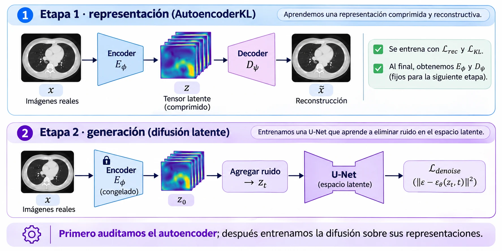{ width=80% .centered}

## Entrenamiento: predecir ruido en $z_t$

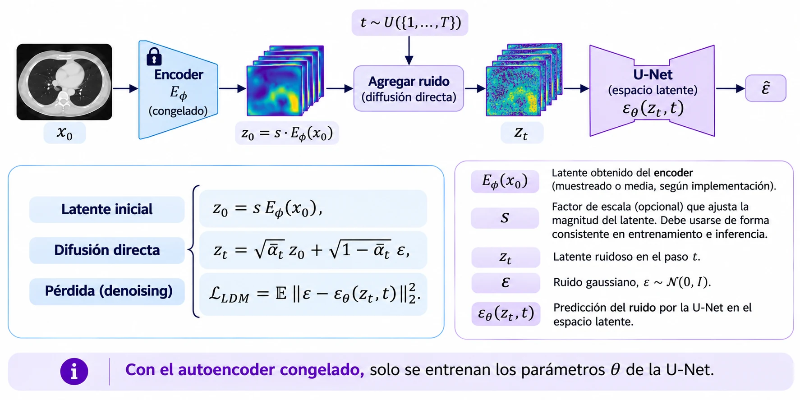{ width=80% .centered}

## ¿El prior del VAE genera los latentes del LDM?

**Son dos mecanismos distintos:**

- El término KL regulariza la distribución condicionada $q_\phi(z\mid x)$ hacia un prior sencillo.
- La **difusión latente** aprende a generar representaciones similares a las que produce el encoder sobre los datos reales.

Por tanto, **el LDM no depende de que cada representación aprendida sea exactamente $\mathcal N(0,I)$**.

En generación, la difusión parte de ruido gaussiano en su tiempo final y estima un nuevo latente $z_0$.

## Generar sin imagen de entrada

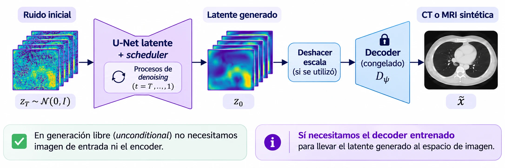{ width=80% .centered}

## La evaluación debe separar tres preguntas

| Componente | Pregunta | Ejemplos |
|---|---|---|
| AutoencoderKL | ¿Qué información pierde al reconstruir? | MAE regional, SSIM, bordes, HU |
| LDM | ¿Genera variedad y anatomía coherente? | Diversidad, anatomía, artefactos |
| Aplicación clínica | ¿Conserva información útil y cuantitativa? | Lesiones, HU, segmentaciones, dosis |

**Una imagen visualmente convincente no equivale a una imagen clínicamente validada.**

## Generación condicionada: puerta a la clase 4

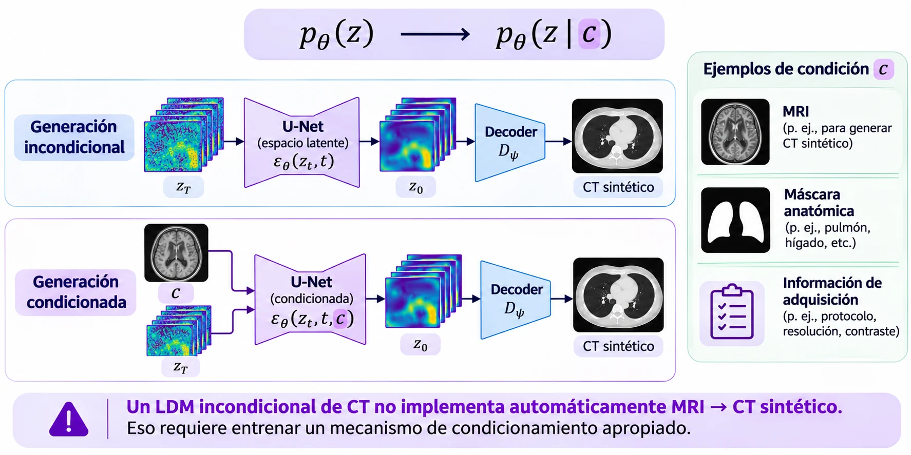{ width=80% .centered}

## Lo que necesitamos recordar

1. El **VAE/AutoencoderKL** proporciona una representación latente que puede regularizarse y evaluarse por reconstrucción.
2. El **LDM** aprende a generar nuevas representaciones en ese espacio mediante difusión.
3. El **decoder** transforma el latente generado de nuevo en imagen.
4. La compresión **reduce ciertos costos**, pero también puede eliminar información médica relevante.

$$\boxed{\text{Reconstrucción fiel}+\text{difusión latente}\ \not\Rightarrow\ \text{validez clínica automática}}$$

## Próxima clase · Aplicaciones médicas

- Modelos generativos volumétricos como MAISI.
- Condicionamiento anatómico y multimodal.
- MRI $\rightarrow$ CT sintética.

